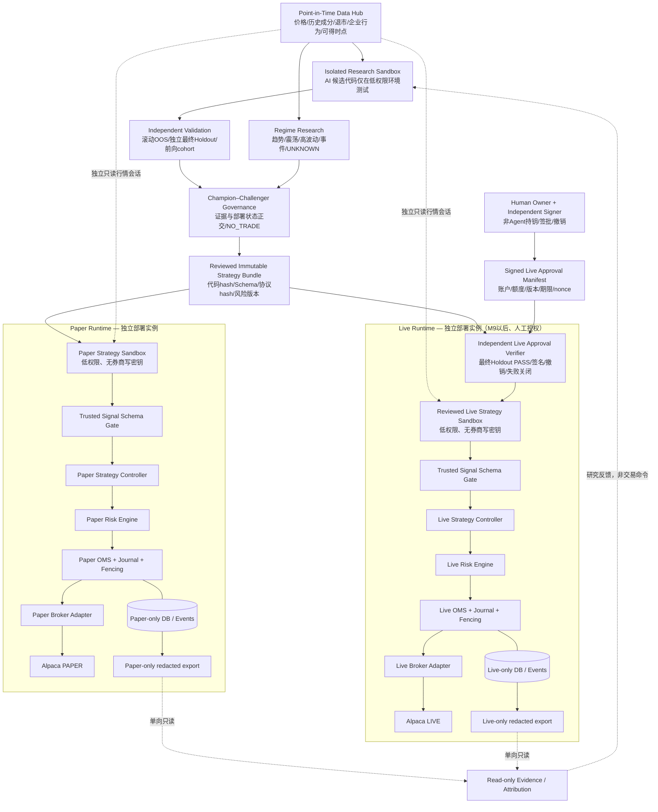

# Shutu AI Trading Lab — AI 自适应量化研究与自动交易平台

> **总体方案 + 开源选型 + 策略生命周期 + Codex 分阶段执行计划（v2.1 / 最终审查补充修订 · 设计冻结候选）**  
> 方案基准日期：2026-11-19（项目设计文件，非收益承诺）  
> 核心架构：**市场状态驱动的多策略系统 + Champion–Challenger 策略进化 + 独立风控**  
> 生命周期：**假设提出 → 点时刻验证 → 样本外与滚动前向 → Shadow/Paper → 人工批准小额 Live → 持续监测/退役 → 审慎扩容及收益提取**  
> 最高原则：**工程通过 ≠ 策略有效 ≠ 真实资金盈利**。现金观望、延长观察或退役，都是合格结果。

---

## 0. 执行摘要与 v2.1 决策

### 0.1 项目唯一目标

开发一套面向**个人小额美股投资者**的、可长期迭代的自适应量化研究与自动交易平台。系统应能自主发现、研究、验证、竞争、选择、部署、降级及淘汰策略；在不同市场状态下灵活配置策略和现金，并在长期**真实资金证据**足够时探索复利积累、资本扩展及投资收益提取，形成工作之外的潜在额外收入渠道。

**收益是可能的后续结果，不是研发验收所能预先保证的目标。** 不能从回测、Paper 或短期 Live 盈利直接推断长期稳定现金流。若研究持续未发现有可靠净优势的策略，系统仍然可以工程验收成功，投资账户持有现金或采用经批准的简单投资方式。

### 0.2 项目不是（非目标）

1. 不是固定策略的买卖机器人，也不是让 LLM 直接调用券商下单的聊天助手。
2. 不是高频交易/微秒级套利系统；不以每日交易次数、月收益率或模型复杂度为 KPI。
3. 不承诺固定月收入、持续跑赢大盘、确定的策略年化收益率或无风险复利。
4. V1 不做杠杆、做空、期权、加密货币、融资融券或不受控的盘前盘后交易。
5. AI 不可以修改不可变的风险门、读取 Live 密钥、访问封存测试集、审批自身策略进入实盘，也不能自动转账或提现。
6. 不把多个 GitHub 项目完整 Fork 后拼成一个难以维护的巨型系统；任何开源复用都必须通过实际 POC 与许可证核查。

### 0.3 五级研发优先级与阶段依赖

| 优先级 | 核心产物 | 对应里程碑 | 进入下一优先级条件 |
|---|---|---|---|
| **P0 基础可信** | 数据质量、研究隔离、订单契约、独立风控、Paper/Live 隔离 | M-1 / M0 / M1 / M2 | E-Gate（工程）关键安全项通过 |
| **P1 研究可信** | 无前视回测、基准、成本模型、独立统计验证、AI 研究原型、最小前向工程烟测 | M3 / M3.5 / M4 | 研究程序能产生完整证据；不以盈利为上线条件 |
| **P2 自适应多策略** | Market Regime、多策略净额组合、Champion–Challenger、淘汰 | M5 / M6 / M7 | E-Gate 通过，S-Gate 提供真实的增量对照证据或明确不足 |
| **P3 前向与受控实盘** | 长周期 Paper 前向、独立签批验证、极小资金 Live Pilot 准入 | M8 / M9 | E=PASS、历史滚动 OOS 与独立前向证据齐备、M9 最终 Holdout=PASS、签批验证通过才可申请 Live；本轮仅做文档 |
| **P4 长期财富管理** | 长期真实净绩效、增额与复利规则、人工收益提取审批 | M10 / M11 | R-Gate 需要长期真实成交和财务证据；不能自动升级 |

**重要区别**：P0/P1 的软件能力可在没有盈利策略时完成；P2/P3/P4 与资金相关的操作须受独立的策略、风险和发布门约束。研发可以继续，实盘不必推进。

### 0.4 三条独立验收线（全阶段强制）

| 维度 | 状态 | 证明什么 | 不证明什么 |
|---|---|---|---|
| **E-Gate 工程** | `PASS / FAIL / BLOCKED_ENV / PENDING_FORWARD_WINDOW` | 数据、代码、权限、订单和恢复机制是否可靠 | 策略能赚钱 |
| **S-Gate 策略证据** | `SUPPORTED / INCONCLUSIVE / FAILED / N_A`；另记 `evidence_state` | 对当前证据阶段的冻结检验是否通过 | 历史 OOS 通过不等于前向支持或 Live 资格 |
| **R-Gate 真实资金** | `NOT_STARTED / OBSERVING / SUFFICIENT_EVIDENCE / INCONCLUSIVE / FAILED` | 实盘可执行性、净额结果、回撤、成本、资本留存与现金流是否满足预注册规则 | 可保证工资之外的固定收入 |

`PENDING_FORWARD_WINDOW` 只表示 **M3.5/M8 已具备可观测能力但预注册的真实前向窗口尚未自然积累完毕**：不是 E=PASS，也不是环境不可用；数据源/权限/时钟等阻止采集则必须如实 `BLOCKED_ENV`。两者均不得越过所需阶段门。任何安全 E=FAIL/BLOCKED、或 S 不足时，不得仅凭模拟收益开启实盘。`R=SUFFICIENT_EVIDENCE` 只能指满足预注册的扩容/提取评估要求，不代表投资将永远赚钱。

---

> **v2.1 文档审查范围**：保留 P0–P4、M-1～M11 原路线，在 M3 后插入 **M3.5 最小前向工程验证**；新增独立运行时、签名签批、持久订单意图与 fencing、Holdout 污染治理及数据供应验收。**当前状态：`M2_GATE_CLOSED / M3_IN_PROGRESS`**（M1 完成并经独立整改验证；用户 2026-11-20 批准关闭 M1 工程门并授权 M2，范围仅合成数据+Fake Broker，见 `docs/reviews/M1-independent-remediation.md` §7）。**BLOCKED_DATA（全市场研究）不解除；M2 不得借工程通过解锁研究数据；完成 M2 后停在阶段门。**（v2.1 文档修订当时状态为 `DESIGN_FREEZE_READY / ENGINEERING_START_APPROVAL_PENDING`。）

## 1. 研究假设与设计价值

- **H1 状态价值**：市场状态驱动的多策略，在匹配资金与风险预算、扣除所有交易和系统费用后，是否优于无状态多策略及最佳冻结单策略？
- **H2 进化价值**：Champion–Challenger 在包含切换成本后，是否比固定 Champion 更稳健？
- **H3 AI 价值**：AI 发现策略，相对透明规则搜索/人工选择是否产生值得支付模型成本的样本外增量？
- **H4 小资金价值**：低冲击、可整笔调仓、低策略容量需求是否提高可执行性？其优势是否被价差、滑点、税费和运行成本抵消？
- **H5 长期价值**：是否可以在受控实盘中，建立具有合理回撤与风险预算的资产积累能力？进一步进行收益提取会不会破坏风险缓冲与复利能力？

每项假设均必须允许得到 `FAILED` 或 `INCONCLUSIVE`；不能因为 AI 能生成大量策略就默认 H1–H5 成立。

---


## 2. 总体架构：研究与交易分离，风险独立否决

**唯一允许共享的是经审查的源代码、构建产物及只读且版本化的研究/策略发布工件；Paper Runtime 和 Live Runtime 是两个独立部署实例。** 它们不共享运行时 OMS、数据库、账户状态、消息队列写通道、凭证、订单执行权限或可写日志。审计汇总只能读取经脱敏的单向导出数据，不能反向向交易环境写入指令。



**部署约束**：`PaperAccount != LiveAccount`；两个运行时的 KMS/OS 秘钥域、服务身份、数据库文件/连接、持久化订单 Journal、执行锁、API endpoint 白名单分别配置。即使同一物理主机也须逻辑隔离，Live 上线前另评估宿主故障域；只有 Paper 部署时，Live 组件是不可实例化的代码/测试替身。不得提供靠布尔开关直接把 Paper 进程升级为 Live 的运行路径。

### 2.1 七个独立边界

1. **Data Plane**：历史/实时数据、`event_time` 与 `available_time`、复权/退市/成分变化及数据授权；不可写研究结论。
2. **Research Plane**：AI 自动研究沙箱，可产出候选代码但**不能获得券商密钥、交易执行端点或最终封存数据**；生成代码只能在低权限隔离进程内运行，不得被 OMS/风控进程 `exec/eval/import` 动态执行。
3. **Validation Plane**：独立的评估程序及冻结协议；研究者不可更改阈值、反复使用封存集进行开发。
4. **Strategy Governance**：Regime、候选池、Champion–Challenger、策略权限、版本控制和现金选择。
5. **Trading Plane**：**每个运行时、每个账户一个独立 OMS**，分别持有专属 Journal、风险执行器及 BrokerAdapter；只消费相应环境授权版本及通过可信 Schema Gate 校验的**数据型信号/目标组合**，不接收 AI 代码、任意脚本或下单命令。
6. **Wealth / Audit Plane**：只读导入的回执、资产净值、外部资金流、运营成本、税务准备金、分红与收益提取建议；**不掌握交易写权限或转账权限**。
7. **Release / Authorization Boundary**：由本人使用与 Agent 隔离的签批终端/私钥批准 Live 运行包，Live 验签器只信任预置公钥和撤销源，不信任研究进程的自报状态。

### 2.2 核心事件契约（Pydantic v2 / JSON Schema）

```text
MarketBar(asset_id, ts_event_utc, ts_available_utc, interval, open, high, low, close, volume, source, adjustment, quality)
CorporateAction(asset_id, effective_at, announced_at, available_at, kind, factor, source)
MarketSnapshot(snapshot_id, asof_utc, knowledge_cutoff_utc, dataset_hash, data_quality)
RegimeAssessment(labels[], confidence, asof_utc, model_version, feature_hash, valid_until)
StrategyArtifact(strategy_id, strategy_version, source_hash, dependency_lock_hash, family, reviewed_build_hash, sandbox_policy_hash, approved_regimes[], evidence_id)
StrategySignal(schema_version, strategy_id, strategy_version, reviewed_build_hash, snapshot_id, target_exposure, expires_at_utc, rationale_hash)
TargetPortfolio(account_id, allocation[], cash_weight, risk_budget_id, timestamp)
TradeIntent(intent_id, release_id, account_id, environment, desired_change, source_hash, expires_at_utc, deterministic_client_order_id)
DurableOrderIntent(intent_id, environment, account_id, payload_hash, release_hash, risk_policy_hash, journal_seq, persist_committed_at)
ExecutorFence(environment, account_id, owner_instance_id, monotonic_epoch, lease_expires_at, lock_version)
RiskDecision(intent_id, policy_hash, allow, reason_codes[], limits_snapshot, decision_at)
OrderEvent(client_order_id, broker_order_id, account_id, order_state, filled_qty, avg_price, received_at)
ExperimentRecord(experiment_id, protocol_hash, all_trials, total_search_budget, trials_including_failures, cost_model_version, dataset_hash, sealed_holdout_access_log, results)
EvidenceRecord(strategy_hash, historical_oos_result, final_holdout_result, forward_cohort_id, evidence_state, measured_at, protocol_hash, contamination_flag)
FinalHoldoutResult(holdout_id, strategy_hash, protocol_hash, status, tested_at, contamination_event, overlap_disclosure_hash)
StrategyPlacement(strategy_hash, evidence_state, deployment_state, strategy_role, authorization_id, observed_at)
HoldoutAccess(holdout_id, unlock_event_id, access_time, unlock_reason, polluted_for_future_selection, analyst_id)
DataVendorAssessment(provider_id, licensed_uses[], universe_history_coverage, delisting_coverage, corporate_actions_coverage, point_in_time_quality, monthly_cost, rejection_reasons[])
LiveRelease(release_id, environment, account_id, strategy_hashes[], build_digest, protocol_hash, policy_hash, capital_cap, max_order_cap, valid_from, expires_at, approval_identity, nonce, revocation_epoch, signature, signature_algorithm)
CapitalFlow(flow_id, deposit_or_withdrawal, settled_amount, external_approval_id, timestamp)
```

关键约束：使用 Decimal 进行资金和数量计算；所有交易必须关联策略 hash、协议、数据快照和账户；每个 `(environment, account_id)` 只能有一个获得有效 fencing 凭据的订单执行者；Paper/Live 数据库、密钥、订单序列、执行权限和运行态审计强隔离。

### 2.3 市场状态是多维标签，不是事后预测牛熊

| 特征维度 | 示例标签 | 可以使用的行为 |
|---|---|---|
| 方向 | `TREND_UP`, `TREND_DOWN`, `RANGE` | 启用符合状态的已验证策略或持有现金 |
| 波动 | `NORMAL_VOL`, `HIGH_VOL`, `STRESS` | 降权、扩大成本边际，必要时停止新增敞口 |
| 事件 | `EARNINGS`, `MACRO_EVENT`, `NO_EVENT` | 只有可验证**发布后可得时间**的信息允许驱动策略 |
| 数据与置信度 | `CONFIDENT`, `LOW_CONF`, `UNKNOWN` | LOW_CONF/UNKNOWN 默认现金或仅平风险 |

先采用可解释的统计/规则 Regime 基线，ML/HMM/变点检测只能作为挑战者。评估指标包含可得时间、延迟、错判损失、标签切换成本、滞回和现金机会成本。不能以使用未来数据事后标注状态证明交易能力。

### 2.4 小资金优先，但不是高频优先

- 策略层支持 `0–100%` 目标仓位、全平/整笔调仓、碎股及现金；**这是接口表达能力，不是默认允许 100% 风险敞口**。
- 同一交易日没有策略层的固定买卖次数上限；但**必须**限制异常下单风暴、违规资金周转、交易成本、操作风险和最大敞口。
- `预估净优势 > 价差 + 滑点 + 手续费/交易费 + 风险不确定性缓冲` 才能发单；模型要能主动输出 NO_TRADE。
- 实时行情先由低成本的规则/统计触发器筛选机会，再按需调用高成本 AI；不让 LLM 每个行情 tick 下单。
- 账户购买力与现金交收必须由实际券商账户返回值和动态规则判定，不能将当天卖出的资金视为可以无限次交易的现金。
- 优先选择流动性合理的股票/ETF；多策略只有**一个**真实账户级 OMS，虚拟策略组合不得重复计算真实本金。

---

### 2.5 部署实例与工件传播契约（P0）

- 研究层仅发布不可变 `StrategyReleaseBundle`（源码/构建 digest、依赖锁、策略、协议、评估状态、Policy hash）；发布包与人类签批记录是**不同工件**。
- Paper 按 Paper 专用配置拉取或导入经审查的只读 bundle；Live 必须经过独立发布服务/离线介质导入**有效签名的批准清单**后才能解锁执行；二者均不从研究 Agent 接收即时下单指令。
- 配置、日志与遥测按环境隔离；跨域可用单向脱敏事件导出用于离线比较，绝不复用交易数据库或订阅同一个可写订单队列。
- 测试：Paper 进程搜索不到 Live 凭证；互换数据库、账户 ID、Broker URL、签批工件均被拒绝；单独停止 Paper 不影响 Live（Live 只在 mock 干运行中验证），反之亦然。

### 2.6 AI 生成策略代码的执行隔离（必需边界，不新增交易服务）

- **研究环境**：AI 生成的 Python/规则代码视为不可信输入，只允许在已有 Research Sandbox 中以非特权身份、只读点时刻数据、受限 CPU/内存/时长、默认禁止网络出口运行；无 Paper/Live 凭证、订单端点、主机密钥或封存 Holdout 读取权限。
- **策略运行环境**：Paper/Live 各自使用**已有运行实例内部的低权限策略子进程**，不与高权限 OMS/风控共进程；只执行匹配已审查 `reviewed_build_hash` 和依赖锁、处于本环境发布白名单的不可变策略工件。研究阶段未经审核生成代码不能直接热加载到任何交易进程；Live 的策略包另需独立发布签批。
- **唯一数据通道**：策略进程只能向可信 `StrategySignal`/`TargetPortfolio` Schema Gate 输出**数据**，不得传递 Python 对象、Pickle、任意可执行代码、券商 API 请求或命令字符串。Gate 检查字段白名单、版本/构建 hash、`snapshot_id`、时间戳/TTL、目标权重合计、资产池、数值有限性与负值/杠杆禁令；无效则 `NO_TRADE + audit`。
- **权限收口**：可信 Controller 将合格信号转换为待审交易意图，之后仍由独立 Risk Engine → OMS → BrokerAdapter 决策。策略沙箱没有直接连接券商或修改 Risk/OMS 数据库的路径；Sandbox 失效、超时或检测到越界行为时冻结新增风险，不直接平仓或重试发单。
- **负例验收**：恶意策略尝试读取环境凭证、打开券商 socket、写 OMS DB、访问 Holdout、提交非法/过期/重放/非数字权重、动态导入高权限 SDK、执行 `subprocess` 时均被拦截或输出被拒绝并记录；在 Paper/Live mock 实例上均验证，不能仅靠 Prompt 禁止。

---

## 3. 开源组合选型与自主研发边界

| 组件 / 开源仓库 | 建议作用 | 第一阶段采用方式 | 必须验证 |
|---|---|---|---|
| [Microsoft RD-Agent](https://github.com/microsoft/RD-Agent) | AI 因子/模型假设与研究循环 | **研究侧 POC**，隔离进程 | 美股数据接口、试验记录、成本、资源限额、输出工件可复现 |
| [Microsoft Qlib](https://github.com/microsoft/qlib) | 研究数据处理、模型和实验工作流 | **研究/回测候选** | US 数据、历史生存偏差、公司行为、时间可得性、5分钟适配及数据许可 |
| [FinRL-X](https://github.com/AI4Finance-Foundation/FinRL-Trading) | 权重合约、回测及 Alpaca 执行候选 | **先 POC，不预设为主底座** | 订单恢复、部分成交、1/5分钟事件、资金交收、风险接口 |
| [alpaca-py](https://github.com/alpacahq/alpaca-py) | 官方券商 SDK，Paper/Live | 首个 BrokerAdapter | 订单类型、碎股、账户类型、429/超时、查单和对账 |
| [TradingAgents](https://github.com/TauricResearch/TradingAgents) | 财报/新闻等深度 AI 研究 | P2 以后按收益/成本证据选装 | 结构化信号、无未来泄漏、模型开销和调用延迟 |
| [AI Hedge Fund](https://github.com/virattt/ai-hedge-fund) | 可审计账本和研究工作流参考 | 优先参考设计而非整仓依赖 | 执行语义是否与真实券商不同；许可证 |
| [NautilusTrader](https://github.com/nautechsystems/nautilus_trader) | 事件驱动交易底座备选 | FinRL-X 不满足事件/OMS 要求时评估 | Alpaca 适配、复杂度、许可证、测试成本 |

**自研部分（长期差异化）：** 数据可得性治理与证据链、策略假设/注册和全试验账本、冻结评估与 Alpha 消融、Regime 的价值检验、Champion–Challenger 规则、独立策略/账户风控政策、Live 发布审批和长期经济绩效归因。

**尽量不自研：** 交易所日历、基础历史数据读写、标准回测框架、券商 API 协议、通用 Agent 编排、通用数据库和图表。可复用不等于可以直接信任，所有软件需锁定 commit/版本、审查 LICENSE/NOTICE 和依赖安全性。

**ADR-001 三选一**：

- A：FinRL-X 能在 POC 通过 OMS/事件验收 → 作为受控交易模块；
- B：不能通过 → `alpaca-py + 自有最小 OMS/风险边界`；
- C：有严格事件一致性需求 → 对 NautilusTrader 另做 POC，不允许两个交易引擎同时拥有同一账户下单权。

不得因仓库 README 声称支持 Live 就判定其适合真实资金交易。

---

## 4. 数据、研究可信度与回测现实性（P0/P1）

### 4.1 数据质量与时间顺序

- 统一 UTC 存储，交易决策按美国交易所日历，显式处理 DST、假期、提前收市、停牌。
- 每个值记录：`ts_event_utc`、`ts_available_utc`、来源、调整方式和质量标志；仅当 `available_at <= decision_cutoff` 可用于策略。
- 维护原始价格与调整后价格，正确处理拆股、分红、除权及退市；仅支持价量时明确披露由此产生的偏差。
- 有限的 ETF 资产池可供首个**工程测试**，但不能仅以当下仍上市的几只股票证明跨股票研究 Alpha。
- 禁止静默前向填充缺失 bar、复权数据覆盖原始数据、后验新闻时间当作发布时点。
- 数据异常触发 `INVALID_DATA → REJECT_NEW_RISK`，不允许 LLM 根据质量不明的数据生成实盘新风险。
- Alpaca Basic 免费实时美股行情主要覆盖 IEX，而非全市场完整 SIP；要求高频精确价差时须单独评估合法数据授权及成本。

**数据供应商准入矩阵（M-1 做可行性盘点，M1 完成实测，M3 冻结研究适用范围）：**

| 必填字段 | 具体检查 | 不合格行为 |
|---|---|---|
| `universe_asof` / 历史成分 | 每个研究日期可重建当时指数/可交易股票池，纳入新增和剔除 | 只有当前成分而宣称长期横截面 Alpha → `REJECT_UNIVERSE` |
| 退市与符号映射 | 退市证券、退市日期、合并和代码变更可追踪 | 缺失却当作幸存股整体样本 → `RESTRICT_SCOPE` |
| 企业行为 | 拆股、分红、合并、特别分配及原始/复权价格一致性 | 无来源或复权不可重算 → `REJECT_DATASET` |
| 点时刻可得性 | 行情/财报/新闻的 `event_at`、`published_at`、`available_at` 分离 | 不能证明当时可获知 → 禁止该特征用于策略 |
| 缺失与覆盖 | 按资产×日期×时间粒度报告缺 bar、停牌、延迟、时钟和质量标志；覆盖阈值按用途预注册 | 关键字段或阈值未知 → `BLOCKED_DATA`，禁止静默补齐 |
| 授权与成本 | 供应协议允许研究、缓存、衍生指标、内部展示及 Live 用途；记录数据留存、导出和月费 | 未确认合法用途、许可超支或资费未知 → 不进入相关环境 |

**可量化规则**：使用 `configs/data_acceptance.yaml` 为各用途填写非空的 `min_coverage_pct`、`max_missing_bars_pct`、`max_arrival_lag_ms`、`max_corporate_action_mismatches`、`max_monthly_data_usd` 与 `required_fields`；按指定资产和窗口计算分母、样本及结果，不以单一全局百分比冒充全部可用。历史成分或退市不可获得时，仅限可验证的受限 ETF 工程实验，明确标 `RESEARCH_SCOPE_LIMITED`，不得声称跨股票策略有效。

### 4.2 冻结的科学验证协议

研究开始之前锁定：资产池、样本时间、研究/验证/封存分割、基准、信号可用延迟、训练预算、成本、目标风险、最大候选数、统计方法、最小经济增量及晋级条件。协议采用 `evaluation_protocol.yaml`，附 hash；AI 不得修改协议。

- **Train/Validation**：候选生成、调参、模型/策略筛选，允许按预注册搜索预算访问。
- **历史滚动 OOS / Walk-Forward**：用于开发阶段的时间序列稳健性评估；尽管每折样本外，若被多轮候选筛选或反复检视，其证据仅支持 `HIST_OOS_SUPPORTED`，**不是 M9 的独立最终 Holdout**。
- **独立最终 Sealed Holdout（M9）**：M3 即封存独立样本 ID、期间、策略族、**事先冻结的候选选择规则**、指标/效应阈值/误报控制/样本量/成本假设、解封权限与判定方法；待 M4–M8 完成候选研究后，在任何 M9 解封之前由独立治理过程按上述规则选定并不可逆冻结**唯一待测 `strategy_hash` / build hash**；M9 对这一版候选**仅执行一次预注册确认**，出具 `PASS / FAILED / INCONCLUSIVE / INVALIDATED`，不得据结果重选策略或重测同一 Holdout。
- **前向 cohort**：在真实事件发生前锁定预测，待未来结果可得才评分；与历史滚动 OOS 及 M9 最终 Holdout 具有明确的时间/资产/事件去重边界。三者重叠必须逐条披露并降级独立性，不能把同一观测当作两份独立证据。
- **Walk-Forward**：使用按时间滚动或扩展的训练窗，在之后的未知区间做预测和模拟执行；标签重叠时用 Purge/Embargo；
- **多重测试**：登记**全部**失败/成功候选、参数组合、Prompt/重试和不完整运行；按实际搜索次数报告多重比较与不确定区间；可按研究特征评估 Deflated Sharpe、PBO、Bootstrap/Reality Check，不能机械套用不适合样本的方法；
- **样本不足**：给 `INCONCLUSIVE` 而不是为了上线降低阈值；分状态的独立样本数不足不能借用全市场表现冒充；
- **回测成交**：以信号产生后可执行价格建模；价差、冲击、延迟、部分成交、未成交、交易费用与现金交收必须进入模型；
- **成交可复现**：同一冻结数据/代码/随机种子/成本模型重复执行，结果在事先规定的数值容差内一致。


### 4.3 必须完成的公平对照与消融（B0–B8）

| 实验臂 | 事先冻结的定义 | 所检验的增量 |
|---|---|---|
| `B0` | 现金/实际可得现金收益口径 | 不交易是否更好 |
| `B1` | 固定宽基 ETF 买入持有，计入分红/交易成本 | 市场自身回报 |
| `B2` | 只用 Train/Validation 选出并锁版本的最佳透明单策略 | 相比最简单可交易策略 |
| `B3` | B2 加事先定义的 Regime 过滤 | 状态过滤的独立增量 |
| `B4` | 固定权重多策略、不使用 Regime | 静态多策略增量 |
| `B5` | B4 加 Regime 路由、不做策略进化 | 状态路由增量 |
| `B6` | B5 加 Champion–Challenger，允许 AI 策略发现 | 策略进化的净价值 |
| `B7` | 与 B6 完全相同的路由/进化规则，但只做规则/有限搜索 | AI 研究相对规则研究的增量 |
| `B8` | 简单定期再平衡/风险预算组合 | 是否只需低成本资产配置 |

**对照实验必须同时采用两个预算视角**：

1. **等试验预算（主要因果比较）**：B6/B7 固定**候选数、参数搜索次数、再训练次数、验证调用、有效搜索时长上限、时间区间、随机种子协议**；失败、重试与被丢弃的候选也计入。为避免 LLM 比规则搜索拥有隐形更多试验，不得让 AI 在同一验证集自由反复试探。
2. **等经济预算（成本敏感性）**：另做相同美元级研究预算（LLM + 计算 + 数据分摊 + 人工干预时间的单列口径）对照；当两者无法同时等额，明确标注非等价并报告数量与费用两套结果，不能宣称严格公平。
3. **同一信息边界**：各臂共享 `snapshot_id`、`knowledge_cutoff_utc`、原始/复权、成分股点时刻、训练/验证/测试分区、可成交时间、现金收益口径、风险目标、组合约束、成本 ×1/×2/×3；与当日成交/财报相关的特征不能提前可见。
4. **同一评价**：预注册净收益、风险匹配效用、最大回撤、尾损、换手/成交、样本数量、置信区间、多重比较校正、研究全成本和实际交易经济成本；按市场状态报告独立机会数、误判与切换成本。
5. **锁定选择逻辑**：B2 仅在开发集选最佳；B6/B7 使用同等且冻结的晋级策略；M9 最终 Holdout 只做一次确认且结果必须 PASS 才能申请 Live；不得按最终 Holdout 重选 B 臂/参数，`FAILED/INCONCLUSIVE/INVALIDATED` 均阻断准入。

**S-Gate**：M3 正式实验运行前在 `configs/evaluation_protocol.yaml` 冻结每个主要检验的效应大小、显著性控制、最小独立样本/事件和费用阈值；未达到应写 `INCONCLUSIVE` 或 `FAILED`。历史 OOS 即使通过也仅标记 `HIST_OOS_SUPPORTED`，永远不足以触发 Live。

### 4.4 Shadow 与 Alpaca Paper 的区别

- `BACKTEST`：历史行情驱动的模拟成交；
- `SHADOW`：实时数据驱动的虚拟独立账本，不向券商发单；
- `PAPER`：Alpaca Paper API 实际返回的模拟订单/成交；
- `LIVE`：真实资金的订单/成交。不同环境的数据、结论、费用和净值不能混用。

Alpaca Paper 不完整模拟真实滑点、市场冲击、队列位置、费用或分红，因此上线前必须增加保守成交成本情景及 Live 试点的真实成交归因。不同报价来源/延迟必须在日志中可见。

---

### 4.5 Holdout 的封存、解封污染与新增前向样本（P1）

- `Sealed Holdout` 默认由独立验证进程只读持有；研究 Agent 无读取、统计查询或间接试探权限。M3 预注册样本 ID/封存 hash、策略族、**唯一候选的事前选择规则**、判定函数、效应下限、成本压力、最小样本、置信/误报控制、一次性解封批准人及用途；**M8 结束、M9 解封前**锁定据此选择的唯一候选 `strategy_hash` / build hash 与审计时间；缺失任何硬阈值不得解封或签发 PASS。
- M9 第一次解封必须由独立验证进程输出 `final_holdout_status`：仅**预注册的指标、统计与成本门全部通过**才是 `PASS`；未达到预注册标准为 `FAILED`，证据/样本不足为 `INCONCLUSIVE`，封存完整性或数据独立性失效为 `INVALIDATED`。**后面三种状态均禁止 Live 准入，即使历史 OOS 与前向 cohort 已通过。**
- 首次解封产生不可删除的 `HoldoutAccess` 事件与 `polluted_for_future_selection=true` 标记。该 Holdout **仅能如实报告本次预注册确认结果**，此后不能在同一策略族后续开发中再次作为独立测试集；失败不能擦除记录后重新筛选参数/候选。
- 同一研究族重新调参、更换特征/Prompt/挑模型、策略退役后重新提案均生成新候选版本和新试验次数；必须采用新的、当时尚未可见的前向观察区间或额外独立数据。不得把重复访问旧 Holdout 冒充样本外确认。
- 前向样本按 `forward_cohort_id + prediction_locked_at + observation_available_at` 逐批封存预测与后续观察；**先产生并锁定预测、后接收真实价格/成交**。新观察只可对先前锁定预测评分；若用来重新选择，就污染该区间对未来版本的确认用途。
- `cohort_overlap_report` 固定列出历史滚动 OOS、最终 Holdout 与前向 cohort 的**日期、资产、事件/标签关联、版本和任何重叠集合**；重叠事件不得在联合效应/置信度中重复计数，不得未经披露标作独立证据。没有独立终检数据时，M9 标 `INCONCLUSIVE` 并等待真正的新独立样本，不能在既有 cohort 上重新挑选。
- 研究预算同时限制 `max_hypotheses`、`max_trials`、`max_validation_queries`、`max_holdout_unlocks`、`max_llm_usd`、`max_compute_hours`，所有失败与人工试探都计入。超预算自动冻结新研究，不因短期亏损而事后放宽。
- 测试：二次解封/未授权查询拒绝；解封后新候选不能引用旧 Holdout 作独立支持；未来观察时间倒流、先验预测未锁定或重用同 cohort 的实验无法得到 `FORWARD_SUPPORTED`。

### 4.6 策略证据状态、部署状态与角色三轴正交

**三个轴不得串接为一条流程**：

| 轴 | 状态 | 语义与守卫 |
|---|---|---|
| `evidence_state` | `NOT_EVALUATED → HIST_OOS_SUPPORTED → FORWARD_OBSERVING → FORWARD_SUPPORTED`，或 `INCONCLUSIVE/FAILED` | 表示研究证据**等级**；必须绑定策略、协议、样本及成本 hash。S=SUPPORTED 不自动赋予部署权。 |
| `deployment_state` | `NOT_DEPLOYED / SHADOW_RUNNING / PAPER_RUNNING / LIVE_RUNNING / PAUSED / RETIRED` | 表示**在哪个环境运行**；`SHADOW_RUNNING` 与 `PAPER_RUNNING` 可以发生在 `FORWARD_OBSERVING` 之前或期间，从而产生前向数据；不是盈利证明。 |
| `strategy_role` | `CANDIDATE / CHALLENGER / CHAMPION_PAPER / CHAMPION_LIVE / NONE` | 表示同环境/市场状态下的选用角色；Paper Champion 由冻结的工程与治理政策决定，**不要求先 `FORWARD_SUPPORTED`**；Live Champion 仅可从已签批白名单中选择。 |

`final_holdout_status = SEALED / PASS / FAILED / INCONCLUSIVE / INVALIDATED` 是**独立终检结果轴**，不能被 `evidence_state=FORWARD_SUPPORTED` 覆盖；M9 之前为 `SEALED`。`QUARANTINED` 是风险/部署隔离动作，不是统计支持状态；实盘观察记作 `deployment_state=LIVE_RUNNING`、`R=OBSERVING`，**不再把 `LIVE_OBSERVING` 当成 evidence_state**。

**合法示例**：`evidence_state=FORWARD_OBSERVING + deployment_state=PAPER_RUNNING + strategy_role=CHAMPION_PAPER + final_holdout_status=SEALED`。这可以持续收集真正前向样本，但不得申请 Live。`HIST_OOS_SUPPORTED` 也可以启动受限 Shadow/Paper，只要工程安全门通过。

**Live 准入硬守卫**：`E=PASS ∧ S=SUPPORTED ∧ evidence_state=FORWARD_SUPPORTED ∧ final_holdout_status=PASS ∧ independent_cohort_check=PASS ∧ 风险门=PASS ∧ 人工签批/验签=PASS`，且签批绑定同一不可变版本、账户和限额。任一 `FAILED/INCONCLUSIVE/INVALIDATED`、缺失/污染证据或验签失败均 `FAIL_CLOSED`。状态与 E/S/R 三条验收线互相独立；不能从任何一个单独状态推导实盘权限。M3.5 短观察只产生 `FORWARD_OBSERVING`，不构成 Alpha 支持。

## 5. 多市场状态、多策略组合与 Champion–Challenger（P2）

### 5.1 策略生命周期状态机（证据、部署与角色独立）

```text
研究工件（不可变）：PROPOSED → GENERATED → SANDBOXED → HISTORICAL_BACKTESTED
证据轴：NOT_EVALUATED → HIST_OOS_SUPPORTED → FORWARD_OBSERVING → FORWARD_SUPPORTED
                          ↘ INCONCLUSIVE / FAILED（任意必要阶段可降级）
部署轴：NOT_DEPLOYED → SHADOW_RUNNING / PAPER_RUNNING → PAUSED / RETIRED
                                   ↘ [仅 M9 终检 PASS + E/S/风控 + 人工独立签批] LIVE_RUNNING
角色轴：CANDIDATE → CHALLENGER → CHAMPION_PAPER（可在 FORWARD_OBSERVING 期间）
                              ↘ [已验签的 Live 白名单与硬风控] CHAMPION_LIVE
终检轴：SEALED → [M9 独立预注册单次解封] PASS / FAILED / INCONCLUSIVE / INVALIDATED
任意越权、异常、证据退化：NO_TRADE / CASH；不自动将 Paper 权限提升为 Live
```

**无循环依赖**：M3.5/M8 的 Shadow/Paper 从 `HIST_OOS_SUPPORTED` 或经许可的研究版本启动，即可产生并锁定前向预测；Paper Champion 不以 `FORWARD_SUPPORTED` 为前置。取得前向证据只是统计状态变化，不改变账户权限。`LIVE_RUNNING` 需要 M9 最终 Holdout=PASS、独立前向支持、风险与签批全部通过，并且仍从独立 Live 部署实例启动。

`NO_TRADE / CASH` 为合法 Champion 结果，可跨市场状态选择。策略工件是 `strategy_id + version + source_hash + data_hash + validation_hash + risk_hash` 的不可变组合；重新调参即新版本和新候选，不得覆盖已批准版本。

### 5.2 Champion–Challenger 竞争政策

1. **同状态竞争**：至少与当前 Champion、现金、最佳冻结单策略和对应无状态组合比较；
2. **不同资金账户不混算**：Challenger 独立虚拟组合，不共享实盘购买力，也不独立向实盘下单；
3. **多目标评分**：净风险调整表现、最大回撤、尾损、交易成本、失败样本、状态错判敏感性、执行偏差和研究成本；
4. **不确定性惩罚**：样本少、参数敏感、回测/前向差异大，不得凭近期高收益晋级；
5. **策略切换成本**：计入换仓价差/税费/卖出交收/机会成本，采取滞回与冷却期；
6. **自动权限**：Paper 可在冻结晋级政策和 E 安全门内自动选择 `CHAMPION_PAPER`、运行 Shadow/Paper 并积累前向样本，**不需先取得 FORWARD_SUPPORTED**；Live 仅可在**最终 Holdout=PASS、已验签的版本白名单、额度、有效期、撤销状态和风控限制**内切换；新策略版本、增额或过期一律重新由独立审批终端签批；
7. **退役与降级**：检测到执行故障、漂移或净效果恶化时，冻结新增风险，必要时恢复现金；无法获得可靠观察时优先 `QUARANTINED`，不伪造退役的统计证据。

### 5.3 策略示范族（仅用于验证流程）

- 趋势/动量、均值回归、波动突破、事件后响应、现金/防御、低成本再平衡；
- 每族至少一个透明规则实现，与 AI 自动研究产生的挑战者做对照；
- 研究的是“在哪些状态、什么成本、什么风险下有效”，而不是先断言哪一种有 Alpha；
- 事件驱动必须记录公告发布与市场真实可获取时间；在没有合规时间戳之前不允许上线该类策略。

---


## 6. 交易执行、独立风险与 Paper/Live 隔离（P0/P3）

### 6.1 OMS 崩溃一致性与单账户执行者 fencing

交易链：`AuthorizedStrategy → AccountNetting → DurableTradeIntent → IndependentRiskDecision → DurableSubmitAttempt → BrokerAdapter → OrderEvents → Reconciliation`。**每个运行时的每个账户只有一个 OMS 和一个具备写权限的执行者**；Paper OMS 与 Live OMS 绝不共享数据库、订单 Journal 或锁。

1. **先持久化、后外发**：在本地事务中写入不可变 `TradeIntent`、策略/风险/批准 hash、确定性 `client_order_id`、风险判定及 `PREPARED` outbox；事务提交并确保持久化后，才能执行任何券商网络发送。网络调用前以持久化提交（SQLite WAL 场景须校验 `synchronous=FULL` 及断电恢复行为）写入 `SUBMITTING/UNCERTAIN` 尝试记录，发单后记录 broker 回执与原始报文 hash。
2. **不声称网络 Exactly-once**：TCP/HTTP 超时、进程崩溃、券商去重失效都可能让订单处于 `UNKNOWN`；本地 exactly-once 状态更新不能证明券商恰好成交一次。发生 `UNKNOWN` 时先按 `client_order_id`、账户开放/历史订单和持仓对账；无法确认则**冻结新增风险，升级人工处置**，绝不盲目重发。
3. **单执行者 fencing**：执行器取得由可信本地协调/存储服务原子递增的 `fencing_epoch` + 有效租约；在启用 Gateway 的模式下，每次 Broker 写操作必须经过独立的**单写者 Broker Gateway**（可与 OMS 同机独立进程），校验 epoch、租约与账号权限，并只向当前持有者授予写能力。旧持有者即使网络恢复也不能再次提交。若 MVP 不实施 Gateway，则强制单宿主/单进程独占 Live 写凭证且不允许多实例/故障转移；**未证明旧实例失去下单能力时，不得通过 Live E-Gate**。单纯数据库锁不能阻止失联旧实例直接调用券商。
4. **订单状态机**：`PREPARED → SUBMITTING → ACK | PARTIALLY_FILLED | FILLED | CANCELED | REJECTED | UNKNOWN`，含 `CANCEL_PENDING`、多次成交增量、补报和撤销拒绝；只允许合法单调状态变化，账户和成交事件去重并保留每个 Broker event ID。
5. **对账和恢复**：进程启动先读取未完 Journal → 取得新的 fencing 权限 → 停止新增风险 → 查询券商订单/现金/持仓 → 幂等重放回执并核对会计余额 → 经风险/数据/批准重验才恢复。无法查单、对账不一致、lease 失效、签批过期始终保持 `RECONCILE_ONLY / HALT_NEW_RISK`。

**必须故障注入**：网络发送前崩溃、发送后收到 ACK 前崩溃、部分成交后崩溃、撤单后未知、broker 5xx/429、过期租约恢复、双实例争锁、主机重启与数据库回滚。≥1,000 次重放/故障组合测试中 0 重复券商模拟订单、0 非法双主写单；`UNKNOWN` 没有可证据化对账就 0 新增风险。所有结果记录在 `artifacts/evidence/M2/`，M8 对 Paper API 再执行实际对账验证。

### 6.2 硬性风险契约（Agent 无权修改）

Live 运行时在**每次启动、每次发单前**必须验证冻结的 `risk_policy.yaml` 完整且 policy hash 与签批一致。以下键对 Live 全部**必填、非 null、数值有限且在已批准范围内**；缺一即 `FAIL_CLOSED`。Paper/mock 也按同一 schema 测试，不允许让策略设置绕过。

```yaml
risk_policy:
  version: 1
  environment: PAPER              # 示例仅供测试；Live 须单独签批
  account_id: PAPER_TEST_ACCOUNT
  max_gross_exposure_pct: 60       # 示例值，不是推荐的实盘阈值
  max_net_exposure_pct: 60
  max_single_symbol_pct: 30
  max_single_order_notional_usd: 100
  max_daily_loss_pct: 2
  max_peak_to_trough_drawdown_pct: 6
  max_abnormal_orders_per_minute: 8 # 异常风暴阈值，不是策略每日次数上限
  max_market_bar_age_seconds: 120    # 仅作为分钟级样例；日线须按交易日历单独定义
  max_account_snapshot_age_seconds: 30
  max_broker_order_ack_wait_seconds: 10
  require_settled_funds: true
  allow_margin: false
  allow_short: false
  allowed_symbols: [SPY, QQQ, IWM]
  recovery_requires:
    - broker_orders_positions_cash_reconciled
    - fresh_data_and_market_clock
    - valid_approval_if_live
    - operator_release_after_incident
```

**判定语义**：敞口与单标的浓度以包括未成交订单预留、当前持仓和假定成交后余额的保守账户权益计算；日损和回撤按预注册权益口径包括已实现及未实现变动，外部入金不掩盖亏损；异常速率在滚动窗口计数（含被拒绝/重试），超过阈值锁住新增风险；数据过期/缺失、时钟漂移、账户状态滞后或账户购买力/已交收余额不足均拒绝加风险。正常策略交易次数不固定封顶，但不得绕过订单风暴和成本门。数据过期判定必须绑定策略所用的 `interval/market_session`，不可把一分钟行情的 120 秒窗口直接套到日线策略。

**故障恢复**：事故状态必须持续存储，不得因重启自动清除。至少完成券商端订单/现金/持仓一致性、行情新鲜度、风险政策和 Live 签批重新验签，以及操作者独立解锁；未知订单、未完成撤单、失联 Gateway 或不完整 risk config 一律维持停止新增风险。恢复减风险类交易须遵守专门预定义且限额的 `RISK_REDUCTION_ONLY` 路径；不能把紧急清仓理解为保证成交。

### 6.3 Paper/Live 完全独立运行时

| 隔离项 | Paper Runtime | Live Runtime |
|---|---|---|
| 部署 | 独立进程/服务身份/配置 | 独立进程/服务身份/配置；**本轮不部署** |
| OMS 与执行锁 | `paper_oms`、Paper Journal/fence | `live_oms`、Live Journal/fence，不共享 |
| 数据库 | 专属实例/路径与备份 | 专属实例/路径与备份，不连接 Paper DB |
| 券商账户/凭证 | Paper account & key，仅 Paper endpoint | Live account & key，仅 Live endpoint；独立 secret store |
| 订单权限 | 仅 Paper 账户订单写权限 | 只授予单写者 Gateway、限本人批准账户/额度 |
| 运行日志/事件通道 | Paper-only 可写命名空间 | Live-only 可写命名空间；向审计单向脱敏导出 |
| 策略代码 | 只在无交易凭证的低权限策略子进程执行，输出受 Schema 约束的信号 | 仅经代码审查、不可变构建及 Live 签批后，在独立低权限子进程执行；不得在 OMS/风控进程执行 |

不得在一个进程里通过 `paper=false` 切换环境；不得从 Paper DB 中挑选订单补写到 Live；同一 `client_order_id` 必须包含环境/账户命名域且由持久化意图确定。研究沙箱没有任何券商写权限。

### 6.4 实盘准入链与生命周期（只设计，不提前执行）

严格链条：`E=PASS + S=SUPPORTED + HIST_OOS_SUPPORTED + FORWARD_SUPPORTED + M9 独立最终 Holdout=PASS + 不重叠/污染披露审查=PASS + 受审核策略代码/Schema/风险=PASS → 策略准入提案 → 独立人工签批 → Live 验签与撤销检查 → 限额匹配 → Live Pilot`。**Holdout 的 `FAILED/INCONCLUSIVE/INVALIDATED` 一律不得获得 Live 资格**；历史滚动 OOS、最终 Holdout、前向 cohort 不得互相替代、重复选择或对重叠样本虚报独立。Paper/Shadow 短期漂亮曲线不等于 `FORWARD_SUPPORTED`。

- 策略包签批绑定 `release_id, account_id, environment=LIVE, strategy_hashes, build_digest, evaluation_protocol_hash, risk_policy_hash, capital_cap, per_order_cap, allowed_symbols, valid_from, expires_at, nonce, revocation_epoch`。
- 签批私钥仅存在于**非 Agent 可访问的本人终端、硬件密钥或独立 Secret Store**；签批器用可信身份验证本人并记录审批时间、决策和审计来源，签名覆盖规范化序列化后的完整内容（例如 Ed25519）；研究/交易 Agent 不得调用签名服务、下载私钥或修改受信任公钥。
- Live Verifier 将随程序独立固化的受信任公钥和策略/风险/构建/账户状态与签名逐项比对；校验签名、当前时刻、nonce/发布序号防旧批件回滚、撤销 epoch/denylist、签批范围、账户和有效期；nonce 用于批准操作防重播，不能误设计为“每笔订单验签只能使用一次”的令牌。**签名验证成功不自动代表可以交易**，还要独立风控与 OMS 放行。
- 人类可撤销 release、缩减额度或缩短有效期；撤销源不可用时，若无法证明撤销状态足够新鲜则 `FAIL_CLOSED`。离线部署无法保证撤销实时到达，必须采用短 TTL 或强制在线撤销检查并明确最大撤销传播时延。
- 自动降权、减风险、停止交易可由受控风控逻辑触发；AI 不得创造新的批准身份、覆盖签名、升级额度、解除熔断或让旧批准回滚生效。

### 6.5 人类批准工件的最低验证与负向测试

| 维度 | 验收负例 | 必须结果 |
|---|---|---|
| 身份/授权 | Agent 模拟 Owner、自建公钥替换信任根 | 拒绝，记录审计 |
| 不可伪造 | 修改签名载荷、替换策略/代码/政策 hash | 拒绝 |
| 范围 | 错误账户、Paper release 试图用于 Live、超资本/单笔额度 | 拒绝 |
| 时效 | not-before、超时、时钟异常、重复 nonce/老 epoch | 拒绝 |
| 撤销 | denylist 命中、撤销源过期/不可达、已撤销旧工件重播 | 拒绝新增风险 |
| 故障 | 秘钥不可读、验签器故障、配置缺项、策略证据退化 | `FAIL_CLOSED` |
| 研究结论 | 仅历史 OOS、前向不足、最终 Holdout FAILED/INCONCLUSIVE/INVALIDATED、样本重叠未披露 | 拒绝 Live 资格 |
| 代码执行 | AI 未审查代码/错误 build hash 尝试在 Live/OMS 进程执行；信号夹带命令或非 Schema 数据 | 阻断执行及下单，记录越界 |

M0 仅用**虚构账户、测试签名密钥与 fake broker** 验证契约；M9 才做真实账户资格/签批操作准备，且必须由用户另行明确授权。不能以本人能在机器上运行 Codex 为理由假定 Codex 无法接触同机私钥；签批隔离要通过实际权限攻击测试证明。

## 7. 长期资产增值、绩效归因及收益提取（P4）

### 7.1 研究收入与投资收益分别核算

| 指标 | 定义及用途 |
|---|---|
| `NAV` | 账户市值 + 现金 - 负债，含未实现盈亏 |
| `NetTradingPnL` | 已实现/未实现投资结果，扣除实际交易成本，不混入外部入金 |
| `TWR` | 时间加权收益，尽量隔离外部充值/提现影响，用于策略评价 |
| `MWR/IRR` | 资金加权收益，体现个人实际入金时间与金额 |
| `AllInNetEconomicResult` | 扣除交易成本、行情、LLM、托管、运维等全系统费用后的净经济结果（税费单独审计/计提） |
| `Drawdown & TailLoss` | 防止靠巨额风险换取看似漂亮的净收益 |
| `CapitalFlows` | 把入金、出金、股息、手续费、估计税务负担与交易收益分别记录 |
| `WithdrawableSurplus` | 通过**人工设定规则**估算的、已交收且不会侵蚀风险预算/税费准备金的候选可提取资金 |

**不能**把未实现浮盈、单月最好收益、模拟账面盈利或新增入金写成“可支配额外收入”。资产增值与现金流来源分别呈现。

### 7.2 资金扩容的保守准则

- 第一目标是先验证实盘成交、风险和策略退化识别，而非第一年扩大资金；
- 拟议扩容必须有足量独立实盘机会和跨市场状态样本、实际成本归因、最大回撤/尾部风险证据及事先预设的扩容判据；
- `SUFFICIENT_EVIDENCE` 只代表可发起扩容审批，不代表自动扩容；每次增额必须由人类批准并记录资金来源；
- 策略容量、券商限制、模型和行情费用需要随资金规模重新评估；
- 连续不达标时自动降权、停止新增风险或退回现金，不以追加本金“救回”亏损策略。

### 7.3 收益提取流程：建议自动化、资金操作人工化

```text
长期 Live 成交与资产流水 → 计算税前/税后估算净结果
  → 排除未实现盈亏/未交收资金/外部入金
  → 预留税务准备金、运营预算、最低投资本金、风险缓冲
  → 提交提款建议（可为 $0）
  → 人工核对券商与税务资料、确认可用现金
  → 用户手动在券商/银行办理提现
  → 对账、记录 TWR/MWR 与后续风险预算变动
```

默认**不实现自动发起银行转账/提现 API**。AI 只能给出计算过程、可提取候选金额和机会成本分析；真正提款必须本人操作。首次提取建议至少经过**跨市场状态、足量真实成交、可持续净收益及回撤风险**的综合证据评审，不以“达到某月收益率”作为触发条件。没有足够证据时输出 `$0 / INCONCLUSIVE`。

税务居民身份、资本利得、股息、预提税及跨境账户义务可能不同，必须另外核实；平台不自动作法律/税务结论，不以税前收益制造“可提现收入”的错觉。

### 7.4 长期目标衡量（不能承诺具体收益）

1. **保本/存活能力**：极端行情下能否受控降敞口、恢复、减少非必要损失；
2. **研究效率**：每个可独立验证策略的全成本、筛掉虚假优势的比例；
3. **经济净价值**：对现金、买入持有和最强冻结简单策略的净增量；
4. **资产积累能力**：更长周期实盘 TWR/MWR、回撤、资本占用、风险预算及复利路径；
5. **收入可行性**：在支付全部成本、税务准备金并保留资本缓冲后，是否存在可审慎提取的已交收盈余。

---

## 8. 成本与可行性（小资金必须先做算账）

### 8.1 成本分成两本账

- `Research Budget`（研发预算）：历史数据、AI 提案、回测、失败实验、开发机电费及工程时间；独立于策略 PnL，不得隐藏为零；
- `Operating Cost`（实际交易运营成本）：实时行情、成交价差/滑点/手续费/监管费用、税务准备金、持续模型调用、主机与监控。只有这本账计入策略的经常性经济可行性；研究预算另列全成本 ROI。

| 成本 | MVP 低成本路线 | 需要升级时 |
|---|---|---|
| 券商模拟账户 | Alpaca Paper 基础接口 | Paper 与实盘不同，仍要监控差异 |
| 市场数据 | 可合法使用的日线、免费 IEX Basic | 全市场 SIP、完整历史成分股、事件点时刻与分钟级高质量数据 |
| LLM | 模型可切换、缓存、每个实验与月度预算硬停止 | 复杂多 Agent/大规模自动搜索；先证明增量 |
| 计算 | 本地 Windows 11 + WSL / Python | 多策略分钟数据及回测需要加速时再增加服务器 |
| 存储 | Parquet + DuckDB（分析）、SQLite（首版事件/元数据） | 并发与审计负荷需要时升级 PostgreSQL |
| 监控 | 本地 Dashboard + 消息告警 | Live 阶段更严格的可靠性和运维成本 |

### 8.2 小本金对成本的敏感性（纯算例，不是定价）

| 本金 | 每月运行成本 $10 | 每月运行成本 $25 | 每月运行成本 $50 |
|---:|---:|---:|---:|
| $500 | 2.0% 本金/月 | 5.0% | 10.0% |
| $1,000 | 1.0% | 2.5% | 5.0% |
| $5,000 | 0.2% | 0.5% | 1.0% |

上表只是固定费用/本金的比例，不包含交易亏损、机会成本和税费，也不能线性推算年收益。**很小的账户即使交易策略有效，也可能完全不值得付费订阅行情或持续调用大模型。** 初期将研究重算尽量离线，实时决策只运行轻量策略，单独报告经营净结果与研究费用。

### 8.3 预算与停止规则（建议初始配置，需 M0 审批）

```yaml
budgets:
  research:
    max_hypotheses: 100
    max_trials: 300
    max_validation_queries: 300
    max_holdout_unlocks: 1
    max_compute_hours: 20
    monthly_llm_usd: 20        # 独立研发预算，超过停止新增研究任务
    per_experiment_usd: 2      # 上限示例；不能靠无限重试刷出盈利策略
    max_concurrent_experiments: 2
  trading:
    monthly_online_llm_usd: 5  # Live 只执行已批准策略，超过则拒绝新研究推理
    unapproved_subscription_usd: 0
  accounting:
    charge_data_and_hosting_to_economic_result: true
    separate_research_and_trading_costs: true
```

上述预算**不是当前服务商价格或收益预测**，仅作 Codex 默认安全配置；实际支付前先评估是否合法可用、有无最低费和账户条件。服务商定价和券商规则可能变动，应通过配置和人工复核更新。

---


## 9. Codex 分阶段执行计划（M-1～M11，含 M3.5）

> **统一任务协议**：每阶段必须交付代码或可复现设计工件、自动测试/故障注入、不可变证据、E/S/R 三轨报告及下一阶段依赖。实际执行需要用户后续明确下达阶段任务；**v2.1 设计冻结候选停在 ENGINEERING_START_APPROVAL_PENDING，不启动 M-1**。研究里程碑允许 `S=INCONCLUSIVE` 并继续工程研发，但不自动获得 Live 权限。

**统一报告**：`docs/reviews/{stage}-engineering.md`、`docs/reviews/{stage}-strategy.md`、`docs/reviews/{stage}-real-capital.md`，其中 `{stage}` 原样取 `M-1`, `M0`, `M1`, `M2`, `M3`, `M3.5`, `M4` … `M11`。证据统一为 `artifacts/evidence/{stage}/`；E 状态 `PASS/FAIL/BLOCKED_ENV/PENDING_FORWARD_WINDOW`（最后一项仅指前向真实观察期未满），S 状态 `SUPPORTED/INCONCLUSIVE/FAILED/N_A` 且必须另外写 `evidence_state`，R 状态 `NOT_STARTED/OBSERVING/SUFFICIENT_EVIDENCE/INCONCLUSIVE/FAILED`。

### M-1：开源底座真实 POC（P0，首个后续工程任务）

**任务**：锁定 RD-Agent、Qlib、FinRL-X、alpaca-py 版本与 LICENSE/NOTICE；评估研究、日线/5分钟、目标权重、最小 OMS/真实券商协议语义及候选数据供应商。必须使用 fake broker 完成确定性下单/崩溃/查单/fencing POC；Alpaca Paper API 仅作可选额外验证，不启动 Live；比较 `FinRL-X` 与 `alpaca-py + minimal OMS`，形成 ADR-001。

**E-Gate**：fake broker 的正常、失败、未知订单与双实例冲突场景**必测并留证**，每个候选有执行日志或因必需环境受阻而 `BLOCKED_ENV`；**mock/fake 通过只证明本地契约，不等于真实券商订单语义已被验证**，Alpaca Paper 如未运行则标 `BROKER_BEHAVIOR_UNVERIFIED`、不能冒充完成 M8；至少 1 个可复现日线与 5 分钟 POC；独立部署与不可共享账户写权限方案可画出/测试 mock；供应商矩阵具备历史成分、退市、企业行为、PIT、许可、成本、覆盖七项字段；上游 SHA 和许可可追踪。**S=N_A，evidence_state=NOT_EVALUATED，R=NOT_STARTED**。

**工件**：`docs/adr/ADR-001-core-selection.md`、`docs/licenses/third-party.md`、`artifacts/poc/M-1/`、三轨报告及 `artifacts/evidence/M-1/`。POC 结论放在 `docs/reviews/M-1-engineering.md`，不另立同名审查报告。

### M0：部署隔离、身份签批契约、工程事件与审计骨架（P0）

**任务**：搭建 Python 3.13 项目/CI（M0 候选运行基线 3.13；M-1 实际运行版本 3.13.15，偏差经用户批准并记录于 `docs/reviews/M-1-independent-review.md` R5）；Pydantic 契约、两套独立 runtime 启动配置（Live 仅 mock 干运行）；测试签名器/验签器；可信公钥部署机制、审批 nonce、过期、撤销、额度/版本 hash 检查；研究及 Paper/Live 策略子进程无券商写权限，可信 Schema Gate 与低权限隔离；手动 Kill Switch 与密钥泄漏扫描。

**未知订单与单写者出口设计契约（M-1 审查增补 R3/R4：M0 只冻结设计，M2 才实施代码与故障注入）**：(a) `SUBMITTING/UNKNOWN` 且请求**可能已到达**券商时，除存在可信未发送证据（如连接在请求构建前被拒）或经真实 Alpaca Paper 验证的明确幂等保证外，**不得补发**；`get_order(client_order_id)` 暂时查无、429、5xx、超时或对账通道不可用**均不得视作"未发送"证明**，一律进入 `HALT_NEW_RISK` 并保留完整日志，自动重试只允许针对只读查询；(b) 发送前崩溃与"发送后收到 ACK 前崩溃"必须区分**可证明事实**与**未知状态**分别记录，不得合并处理；(c) 对存在不确定结果的旧意图，不得生成任何"替代意图"绕过暂停；解除暂停须操作人显式授权并附已完成的券商订单/持仓/现金对账证据；(d) 每个 `(environment, account_id)` 只能有**一个**获得券商写权限的可信执行者；本地 fencing token/租约不是券商侧远端保证，旧 epoch 必须在**唯一订单出口**被拒；任何可能直接访问券商写 API 的进程、SDK、Agent/MCP 工具、异常恢复与运维脚本都不得绕过该出口；起步阶段以最小可信出口（单宿主、单进程持有写凭证）实现，不引入未经证明必要的中间件组件。

**E-Gate**：100% 已登记的跨域访问、策略代码越权、非法信号和假签批负例被拒；Paper 运行时不存在 Live 密钥/DB/OMS/endpoint；错账户、篡改 hash、超额度、过期、撤销/失联验签均 `FAIL_CLOSED`；无需或无法取得真实 Live 密钥。**S=N_A，evidence_state=NOT_EVALUATED，R=NOT_STARTED**。

**工件**：`src/trading_lab/contracts/`、`src/trading_lab/security/`、`configs/paper/`、`configs/live/`（仅模板）、`tests/security/`、`docs/adr/ADR-002-isolation.md`、三轨报告及阶段证据。

### M1：数据供应准入与点时刻可得性（P0）

**任务**：建立原始/复权/成分历史/退市/企业行为/公告时间模型和 UTC/ET 日历；编写供应商授权成本、覆盖/缺失/延迟矩阵；按 `configs/data_acceptance.yaml` 的非空阈值验收每种用途；限制不合格资产池。

**E-Gate**：全部注入的未来记录被阻断；质量测试报告每类字段的分母、缺失数、覆盖率、实际延迟和许可证状态；关键数据缺失产生 `BLOCKED_DATA/RESTRICT_SCOPE` 而非默默替代；snapshot hash 可重算。**S=N_A，evidence_state=NOT_EVALUATED，R=NOT_STARTED**。

**工件**：`src/trading_lab/data/`、`configs/data_acceptance.yaml`、`tests/no_lookahead/`、`docs/adr/ADR-003-data-contract.md`、`artifacts/evidence/M1/data-vendors.md`、三轨报告。

### M2：独立风控与 OMS 崩溃一致性（P0）

**任务**：实现持久化订单意图/outbox、风险快照、确定性订单 ID、模拟券商、部分成交和撤单；只接收可信 Schema Gate 验证过的策略信号，不允许 AI 代码在 OMS/风控内执行；单账户写权限、单写者 Gateway 或单宿主不可并发验证、租约/fencing；失败后查单和真实账本对账；定义并严格校验全部 Live 风险强制字段（仅测试模板，不开 Live）。

**E-Gate**：≥1,000 次重复/故障组合中 0 重复 mock-broker 单、0 双主写、0 无意图直接发单，非法信号/脚本注入/动态代码执行 100% 被拒；在“发出后收到 ACK 前崩溃”等六类场景中 `UNKNOWN` 先对账、未解决时 0 新增风险；风险必填项缺失/过期数据/账户不一致 100% 拒绝；恢复需经对账 + 操作人解锁。**S=N_A，evidence_state=NOT_EVALUATED，R=NOT_STARTED**。

**UNKNOWN 盲重发与 fencing 出口负例（M-1 审查增补 R3/R4，可与上述验收合并断言）**：故障注入必须覆盖——请求已送达但响应丢失、响应延迟/乱序可见性、网络分区与进程重启、双实例争写、查单接口不可靠（429、5xx、超时、**暂时查无记录**）；全部未证实分支断言 **0 新增风险、0 盲重发、0 替代意图**；stale executor 休眠后恢复、租约过期、两实例同时启动、旧 token 写入、唯一订单出口不可用均必须 fail-closed；fake broker 的 `valid_fences` 网关行为属 **mock-only 证据**，真实 Alpaca 的幂等窗口/权限/网络行为仍为 `BROKER_BEHAVIOR_UNVERIFIED`，在 Alpaca Paper 实测通过前不得以本地 fencing 冒充券商侧保证（M0 任务中 "(a)–(d)" 契约在本阶段全部转化为自动测试断言）。

**工件**：`src/trading_lab/risk/`、`src/trading_lab/oms/`、`src/trading_lab/brokers/`、`configs/policies/risk_policy.paper.example.yaml`、`tests/fault_injection/`、`artifacts/evidence/M2/`、三轨报告。

### M3：透明规则基线、现实回测与冻结研究协议（P1）

**任务**：基线 B0–B8 的可执行实验夹具、现金/买入持有/单规则；延迟、价差、未成交、退市/复权与资金交收模型；分开登记历史滚动 OOS、独立最终 Holdout（仅 M9 解封）与未来前向 cohort 的**不重叠/重叠披露边界**、Walk-Forward、Purge/Embargo；预注册最终 Holdout 的**唯一候选选择规则**、PASS/FAILED/INCONCLUSIVE 判定函数和两套 AI vs 规则预算、统计阈值及试验上限；候选策略 hash 将在 M8 结束、M9 解封前按预注册选择规则冻结。

**E-Gate**：同一数据/seed/协议 hash 结果在预设容差内一致；封存数据未授权访问 100% 被阻断；假造未来价格/过多试验/不同搜索预算被检测；初始 Holdout 状态为 `SEALED` 且独立时间/事件范围可审计；合成测试集可模拟 `PASS/FAILED/INCONCLUSIVE/INVALIDATED` 和重叠泄漏及解封日志，真实 Holdout 不得在 M3 解封。**S=INCONCLUSIVE/N_A，evidence_state=NOT_EVALUATED（或仅 HIST_OOS_SUPPORTED，不具 Live 资格），R=NOT_STARTED**。

**工件**：`src/trading_lab/backtest/`、`src/trading_lab/validation/`、`configs/evaluation_protocol.yaml`、`docs/adr/ADR-004-evaluation.md`、`artifacts/evidence/M3/`、三轨报告。

### M3.5：最小 Shadow/Paper 前向工程验证（P1，新增）

**任务**：以一个冻结透明规则策略在真实到达的数据上先锁预测再观察；优先 Shadow，仅需时连接 Alpaca Paper，且不得取得 Live 密钥。验证事件时钟、重启、重复 event、订单幂等、持仓/现金对账、监控与日志；把前向 cohort 存入独立账本。

**E-Gate**：至少 5 个可观察美股交易日或等效预注册前向事件窗（不得人工合成冒充真实前向时长）、至少 1 次断网/重启和 1 次重复事件恢复，全部可重放；0 未经风险批准的真实券商模拟订单，0 重复 Paper 订单；真实前向窗口尚未积累完成且采集条件正常时标 **`E=PENDING_FORWARD_WINDOW`、`forward_window_status=ACCUMULATING`**，不能标 `PASS`；数据源权限、进程或时钟等客观环境阻止采集时才标 **`E=BLOCKED_ENV`** 并列出故障，不造假。窗口自然满足且故障测试通过后才 `E=PASS`。**S=INCONCLUSIVE，evidence_state=FORWARD_OBSERVING，deployment_state=SHADOW_RUNNING/PAPER_RUNNING；R=NOT_STARTED；绝不据短观察申报 Alpha 或开放 Live**。

**工件**：`apps/trading_daemon/`（Shadow/Paper 最小模式）、`tests/forward_smoke/`、`artifacts/evidence/M3.5/`、三轨报告。

### M4：AI 策略研究工厂（P1）

**任务**：AI 提案、低权限无网/无密钥沙箱执行、人工审查后不可变候选构建 hash、Schema 信号边界、研究预算和不可删除全试验账本；对接 RD-Agent/Qlib 的研究接口；严格隔离 sealed/污染过的 Holdout、统计请求和券商写接口。

**E-Gate**：至少 3 个独立研究假设完整登记成功/失败/重试、计算/LLM 成本和数据时点；超过搜索预算、封存查询/权限跨界、未审核代码直入 OMS/Live 或信号夹带命令被 100% 拒绝；以合成 fixture 证明解封后污染且无法再作为独立证据；真实封存集仍保持密封至获授权最终检验。**S 按历史协议出具，若支持仅 `HIST_OOS_SUPPORTED`；R=NOT_STARTED**。

**工件**：`src/trading_lab/research/`、`src/trading_lab/strategies/registry/`、`artifacts/experiments/`、`artifacts/evidence/M4/`、三轨报告。

### M5：市场状态识别与误判价值（P2）

**任务**：趋势/震荡/高波动/事件多维标签、UNKNOWN、滞回和可得时间；比较 B2/B3/B4/B5 的净经济价值、错判损失和切换频率。

**E-Gate**：全部未来状态泄漏和过期快照被拒；缺失输出 UNKNOWN/NO_TRADE；滞回/回放一致。**S 按冻结协议报净增量或 INCONCLUSIVE，历史证据不能提升到 FORWARD_SUPPORTED；R=NOT_STARTED**。

**工件**：`src/trading_lab/regime/`、`tests/regime_misclassification/`、`artifacts/evidence/M5/`、三轨报告。

### M6：Champion–Challenger、证据晋级和淘汰（P2）

**任务**：研究版本不可变、`evidence_state / deployment_state / strategy_role / final_holdout_status` 四轴互不推导的状态守卫、策略退化/降级/现金、切换成本；支持 `CHAMPION_PAPER + FORWARD_OBSERVING` 产出前向数据，不将 `FORWARD_SUPPORTED` 作为 Paper 前置；Live 独立检验终检 PASS + 前向支持 + E/S/风控/签批；B5/B6/B7 消融。

**E-Gate**：伪造状态、旧/终检 FAILED 或 INCONCLUSIVE Holdout、未达前向样本、Paper/Forward 循环依赖、篡改版本/审批、退役策略自动复活全部被拒；NO_TRADE 合法；报告策略晋级/降级/冻结时的来源。**S 仅在独立新前向协议满足时可给 FORWARD_SUPPORTED，否则 INCONCLUSIVE；R=NOT_STARTED**。

**工件**：`src/trading_lab/evolution/`、`tests/strategy_lifecycle/`、`docs/adr/ADR-005-evolution-policy.md`、`artifacts/evidence/M6/`、三轨报告。

### M7：多策略组合、小资金与成本约束（P2）

**任务**：多策略在账户层净额化、0–100% 目标表达但受严格敞口上限；合规资金、现金、成本和碎股检查；B0–B8 同数据时点、等试验数与等经济预算两套比较。

**E-Gate**：冲突信号不产生对敲；交易与余额按最小精度对账；超阈值订单、异常风暴、过期行情拒绝；所有实验臂完整输出费用和失败次数。**S 按预注册经济净效应/统计阈值判定，报告市场状态及多策略是否确有增量，未证实可为 FAILED/INCONCLUSIVE；R=NOT_STARTED**。

**工件**：`src/trading_lab/portfolio/`、`src/trading_lab/costs/`、`tests/meta_portfolio/`、`artifacts/evidence/M7/`、三轨报告。

### M8：长周期 Alpaca Paper / Shadow 前向（P3）

**任务**：按锁定策略与统一快照持续运行与历史滚动 OOS、最终 Holdout 明确隔离的前向 cohort；M8 结束时按 M3 冻结的选择规则签发唯一候选版本冻结记录（解封前、不可重选）；真实 Paper API 订单与回执/资金对账；调度、告警、恢复、数据质量/交易成本记录。60 个交易日可作为初步**工程稳定性**观察点，但不作为必然 Alpha 证明。

**E-Gate**：每一笔 Paper 单都有对应意图、风控、broker 回执/成交及对账；重复事件/断线恢复无未解决重复单；完整 Paper/Live 隔离；结果为连续真实前向时间序列（不可用回填代替）。**S=SUPPORTED 且 `evidence_state=FORWARD_SUPPORTED` 只有在预注册前向数量/经济效应/误报控制均通过时才成立，否则 INCONCLUSIVE/FORWARD_OBSERVING；R=NOT_STARTED**。

**工件**：`tests/paper_e2e/`、`docs/runbooks/`、`artifacts/evidence/M8/`、三轨报告。

### M9：策略增量确认及独立 Live Pilot 准入（P3）

**任务**：独立验证进程按 M3 预注册检验协议/选择规则、并校验 M8 结束时封存的唯一候选 hash/成本/统计/样本阈值**仅解封一次最终 Holdout** 并固定 `PASS/FAILED/INCONCLUSIVE/INVALIDATED`、污染日志与 `cohort_overlap_report`；逐项检查 B0–B8 等预算、历史滚动 OOS/最终 Holdout/前向 cohort 不重叠或如实披露的独立性；对真实运行版本准备人类签批清单、账户资格/资金规则/撤销和回滚演练，所有安全负例先用 mock。**本 v2.1 交付不含 M9 实施，也不含 Live 真实交易授权**。

**E-Gate**：Live 验签器对签名篡改、旧 epoch、撤销、错账号、错风险 hash、超额、失效条件全拒绝；只有经明示本人批准的部署才可能开启真实交易；OMS 与风控故障测试已过。**M9 最终 Holdout 必须 `PASS`，且 S=SUPPORTED、evidence_state=FORWARD_SUPPORTED、独立前向 cohort、风险/版本/签批均有效时才可以提交审批；`FAILED/INCONCLUSIVE/INVALIDATED` 或未解封禁止 Live，绝不以其它 OOS/前向结果替代；R 在审批/实盘前为 NOT_STARTED，实际授权启动后为 OBSERVING**。

**工件**：`docs/releases/live-pilot-approval.md`（模板，非有效签名）、`tests/live_safety_dry_run/`、`artifacts/evidence/M9/`、三轨报告。真实签批工件必须保存在与 Agent 隔离的批准存储，不放入 Git。

### M10：长期 Live 监测、退化治理与审慎扩容（P4）

**任务**：真实成交滑点、费用、净值、TWR/MWR、漂移与状态错判持续归因；已签批白名单内受控降权；人工重新批准任何增额或新策略版本；失效自动 NO_TRADE。

**E-Gate**：撤销/过期/证据退化后新增风险锁住且记录对账；任何资金上限变动未经新签批被拒绝。**S 可以退回 INCONCLUSIVE，证据状态按实际降级；R 仅在长期预注册实盘样本和费用/回撤/可负担门槛全部满足时可评估 SUFFICIENT_EVIDENCE，不能自动扩容**。

**工件**：`src/trading_lab/monitoring/`、`docs/reviews/M10-real-capital.md`、`artifacts/evidence/M10/`、三轨报告及审慎扩容审批/拒绝记录。

### M11：复利、资金积累与人工收益提取建议（P4）

**任务**：分别统计资金流、未实现盈亏、已实现损益、交收资金、研究/运营成本、税务准备金；计算提取建议（可为零），仅由本人在券商/银行端手工执行资金操作。

**E-Gate**：提现 API 或研究 Agent 直接转账权限不可达；账本收益与资金流清晰区分；可重放提取计算。**S 继续独立评估策略；R 不充分时必须输出 `$0 / INCONCLUSIVE`，不能凭某月盈利自动提取**。

**工件**：`src/trading_lab/capital/`、`src/trading_lab/wealth/`、`docs/adr/ADR-006-capital-policy.md`、`artifacts/evidence/M11/`、三轨报告。

## 10. 可量化验收矩阵与故障集

### 10.1 工程（E）强制 100% 通过的安全断言

| 核心安全测试 | 硬性要求 |
|---|---|
| 研究进程访问 Paper/Live 写接口 | 全部拒绝，测试有日志 |
| AI 未审核策略代码在 OMS/风控进程执行或使用券商密钥 | 全部拒绝；低权限策略子进程、可信 Schema Gate、恶意文件/网络/进程/信号负例通过 |
| Paper 启动携带 Live key / URL | 全部拒绝，不能进行网络实盘写操作 |
| 无签批 Live、签批过期、超额度、不同策略 hash | 全部拒绝 |
| 强制违规交易（超额度、未交收资金、未知证券、异常价格） | 全部由独立风控拒绝 |
| 同一订单 ID 重放 / 失联恢复 | 在故障注入及≥1,000 次重复事件测试中**0 重复模拟 Broker 订单**；未知状态对账之前不重新发送 |
| 持久化意图与发单后崩溃 | 每单先持久化 Journal；提交后崩溃恢复必须查单，无法确认为 `HALT_NEW_RISK` |
| 双实例冲突与 fencing | 旧 epoch/过期租约写入全部拒绝；不能验证单写者就阻断 Live |
| 签批授权与撤销 | 身份、公钥、签名、工件 hash、额度、时间窗、nonce、撤销不符全部拒绝 |
| Live 风控字段缺失 | 必填风险上限缺项/null/过期统一 fail closed |
| 部分成交、撤单未知、持仓与 broker 不一致 | 冻结新增风险、查询状态、保留完整审计 |
| 数据异常、时区/美股 DST、复权和发布时间混淆 | 拦截全部预设的未来泄漏与数据损坏 fixtures |
| 数据供应商历史成分/退市/企业行为/许可不完整 | 供应商矩阵形成按用途 `REJECT/RESTRICT_SCOPE/BLOCKED_DATA`，不能误报可研究 |
| Holdout 二次解封/污染后再次当独立 OOS | 拒绝或降级为污染样本；事件与全部研究次数不可删除 |
| M9 最终 Holdout FAILED/INCONCLUSIVE/INVALIDATED/SEALED 却申请 Live | 100% 拒绝；单次预注册 PASS 与独立性报告必需，历史滚动 OOS/前向不能代替 |
| M3.5 窗口正常积累但未满足预注册观察时长 | `E=PENDING_FORWARD_WINDOW`，不是 `PASS` 或 `BLOCKED_ENV`；真实采集故障才 `BLOCKED_ENV` |
| 研究 Agent 修改协议或封存集 | 拒绝，记录审计 |
| 策略未批准自动上 Live | 拒绝；Paper 允许在规则内自动进化 |
| AI 提现/资金转出 | 完全禁止任何执行路径 |

这些是**测试覆盖范围内**的断言，生产中“零故障”仍要通过长期监控来判断；不能以测试通过保证永远不会发生事故。

### 10.2 策略（S）证据指标

每次策略审查至少包括：封存 OOS/滚动前向净收益、匹配风险的 B0–B8 增量、最大回撤、尾损、换手、成交率、不同状态下独立样本数、置信区间/多重比较修正、成本 ×1/×2/×3 压力、Regime 误判与策略切换成本、参数邻域敏感性、研究 Token/数据/计算费用。

**策略证据门槛不得事后更改**。M3 阶段内冻结协议后才可执行正式验证；M9 最终 Holdout 必须在单次解封时按冻结条件 `PASS`，`FAILED/INCONCLUSIVE/INVALIDATED` 不具 Live 资格；所有滚动 OOS、终检与前向 cohort 的时间/资产/事件重叠必须报告，不得双计；填写目标效应大小、主要检验、误报控制、最小独立机会数、折数或观察窗口与成本假设；若为 null，一律不能 S=SUPPORTED。另报 `evidence_state`：历史 OOS 只允许 `HIST_OOS_SUPPORTED`，实际新时段的事前锁定预测经过预注册前向检验才允许 `FORWARD_SUPPORTED`。M3.5 的短期 Shadow/Paper 一律只作工程证明。

### 10.3 真实资金（R）证据指标

记录 Live 每笔买卖的决策价、报价/可用时间、券商回执、实际成交及滑点、净现金流、真实佣金/税费、资金冻结与交收、现金分配、TWR/MWR、累计净回报、回撤、策略失效及中断原因、运行月成本与扩容后的增量可行性。**真实交易成本与实际收益验证无法在纯模拟盘中提前完成**。

Live Pilot 的必要条件包括：E=PASS、S=SUPPORTED、`evidence_state=FORWARD_SUPPORTED`、**`final_holdout_status=PASS` 且前向/OOS/终检独立性审计通过**、策略代码审查与受限 Schema 信号验证、本人独立签名批准且 Live 验签器通过、账户/KYC/权限/费用核实、已生效且非空强制风控限制、撤销源可用和实时告警。进入后 R 初始仅为 OBSERVING；扩容和提现另需 R 证据，不得用一次获利推断长期能力。

### 10.4 事故和错误市场假设清单

- 数据：假期、提前收市、停牌、拆股、复权/退市、缺失 bar、乱序、旧新闻重放与错误时区；
- 研究：封存集泄漏、Holdout 解封污染后二次选择、过多候选或 Prompt 重试漏计、结果筛选、过拟合、低样本、不可复现、参数临时改变；
- 状态：状态误判、突发高波动、事件发布时延、标签抖动、市场状态未知；
- 交易：两策略冲突、双进程下单、失效 fencing 租约、发单前/后崩溃、重复 websocket、429/5xx/超时、未知撤单、部分成交、交收资金不足；
- 系统：机器重启、代理改变、网络抖动、主机时钟跳变、密钥错误、数据库中断、LLM 预算耗尽；
- 资金：入金/提现被误算成投资收益、未实现盈亏当作可提取资金、税费漏计、超风险预算扩容。

---

## 11. 仓库结构、运行方式及审计目录

```text
shutu-ai-trading-lab/
  docs/
    plans/                      # v2.1 总体方案和 Codex 阶段任务书
    adr/                        # 架构和政策变更决定
    reviews/                    # {stage}-engineering / -strategy / -real-capital
    research/                   # 预注册协议、失败候选、消融与漂移
    releases/                   # 人工 Live 发布/撤销/增额及回滚记录
    runbooks/                    # 故障与恢复、kill switch
    licenses/                   # 唯一清单 docs/licenses/third-party.md
  configs/
    paper/                       # 无 Live 密钥；测试配置
    live/                        # 只有模板；密钥由独立 secret store 注入
    policies/                    # frozen risk / promotion / capital policies
    evaluation_protocol.yaml    # 研究协议冻结+hash
    data_acceptance.yaml         # 供应商/覆盖/授权与成本门
  src/trading_lab/
    contracts/ data/ research/ validation/ backtest/
    regime/ strategies/ evolution/ portfolio/
    risk/ oms/ brokers/ security/ audit/ monitoring/
    capital/ wealth/             # 资产增长与提取建议
  apps/
    research_worker/ validator/ strategy_controller/
    trading_daemon/ dashboard/    # Paper 与 Live 使用独立启动入口/运行态存储
  tests/
    unit/ contract/ security/ no_lookahead/
    backtest_realism/ oos/ regime/ evolution/
    fault_injection/ forward_smoke/ paper_e2e/ live_safety_dry_run/
    capital_accounting/
  artifacts/
    datasets/ experiments/ evidence/ poc/ # 按 stage 隔离；失败工件保留
  scripts/
    check_environment.py
    smoke_mock.py
    run_poc.py
    compare_baselines.py
    verify_live_blocked.py
    reconcile_paper.py
    generate_gate_report.py
  pyproject.toml
  README.md
```

### 11.1 推荐技术栈

- Python 3.13 为核心研发语言（Pydantic v2、pytest、hypothesis），避免 MVP 跨语言复杂性（M-1 实际运行 3.13.15；从 v2.1 原定 3.11 的偏差已经用户批准，2026-11-19，记录于 `docs/reviews/M-1-independent-review.md` R5；研究侧隔离环境兼容性另行验证）；
- Parquet + DuckDB 用于离线行情/回测分析；SQLite WAL 起步用于研究任务和**分别独立的 Paper/Live** 低并发 Journal；不可因为是同一 SQLite 服务器就复用数据库；增加并发时可评审 PostgreSQL，仍需按环境隔离与执行者 fencing；
- Streamlit 首版**只读** Dashboard，后期可替换为 API + Vue；可展示 Paper/Live 汇总但不拥有执行写权限；
- 本地 Windows 11 + WSL AlmaLinux 8 研发；进入 Live 前必须有可恢复的常驻服务、独立告警、备份与恢复演练；
- 所有金额/证券数量用 Decimal；密钥不进入仓库、测试快照、研究日志或 LLM 提示词。

### 11.2 每阶段必须提交的机器可审计证据

```text
docs/reviews/{stage}-engineering.md     # commit / tested commands / environment / PASS|FAIL|BLOCKED_ENV|PENDING_FORWARD_WINDOW
docs/reviews/{stage}-strategy.md        # protocol hash / all_trials / evidence_state / S-Gate
docs/reviews/{stage}-real-capital.md    # live receipts / exposure / cost / TWR-MWR / R-Gate
docs/adr/ADR-*.md                  # decision, rejected alternatives, risks
artifacts/experiments/<id>/       # immutable data hash, code hash, model, seed, metrics, failures
artifacts/evidence/{stage}/       # logs, fault injection, 账户对账和签批负例证据
```

阶段不能因失败而自动降低验证阈值或删除失败实验。若执行环境阻塞，标注 `BLOCKED_ENV` 与复现步骤，不得生成虚假测试结果。研发代码可以在授权范围内提交推送；**实盘下单、策略实盘首次发布、增资或资金转移必须由真实账户所有者单独明确授权**。

---

### 11.3 唯一工件路径与权限边界（v2.1 规范）

- 规划文件：`docs/plans/Shutu_AI_Trading_Lab_Architecture_and_Codex_Plan_v2.1.md`、`docs/plans/Shutu_AI_Trading_Lab_Codex_Execution_Plan_v2.1.md`；旧版不作为新任务执行入口。
- M-1 POC 分析包含在 `docs/reviews/M-1-engineering.md`；只有一个许可台账 `docs/licenses/third-party.md`；版本选择 `docs/adr/ADR-001-core-selection.md`；运行证据 `artifacts/poc/M-1/` 与 `artifacts/evidence/M-1/`。
- 任何阶段使用 `docs/reviews/{stage}-engineering.md`、`docs/reviews/{stage}-strategy.md`、`docs/reviews/{stage}-real-capital.md`；M3.5 文件名原样包含句点。禁止产生任何另一套并行命名的权威报告。
- `docs/releases/live-pilot-approval.md` **只是供将来人工签批的审查模板**，不能存放有效私人签名或私钥；真实批准工件在非 Agent 可写存储中保存，由 Live runtime 验证。文档生成不意味着授权。
- E/S/R 报告必须包含 `stage_id / commit / code_hash / protocol_hash / environment / test_commands / evidence_paths / findings / status / evidence_state / deployment_state / strategy_role / final_holdout_status / forward_window_status / next_gate / approver`；`NOT_APPLICABLE` 须解释，不能代写 `PASS`。


## 12. Codex 后续执行提示词（仅供审核通过后使用）

> **审查停止规则**：此处为未来 M-1 可复制任务文本，生成或打开文档不构成启动 M-1 的指令。当前 `DESIGN_FREEZE_READY / ENGINEERING_START_APPROVAL_PENDING`。

```text
你是 Shutu AI Trading Lab 的平台工程与严格验收负责人。
先完整阅读：
docs/plans/Shutu_AI_Trading_Lab_Architecture_and_Codex_Plan_v2.1.md
docs/plans/Shutu_AI_Trading_Lab_Codex_Execution_Plan_v2.1.md

仅在用户之后明确批准启动 M-1 时，才执行 M-1。禁止自动推进后续阶段。
目的：评审 RD-Agent/Qlib/FinRL-X/alpaca-py 等公开候选的真实代码、许可、依赖、PIT数据、历史成分与退市、交易适配。
只用合法数据、mock broker、Paper 受控测试；不建立 Live Runtime，不获取/请求真实账户或密钥。
评审范围：事件/分钟能力、订单发出后崩溃、未知查单、双主 fencing、权限隔离、签批验签 mock、数据供应许可与成本。
记录采用或不采用的证据，不应凭 README 直接断言通过，不应完整 Fork 多个项目。
统一提交：
- docs/reviews/M-1-engineering.md
- docs/reviews/M-1-strategy.md (S=N_A; evidence_state=NOT_EVALUATED)
- docs/reviews/M-1-real-capital.md (R=NOT_STARTED)
- docs/adr/ADR-001-core-selection.md
- docs/licenses/third-party.md
- artifacts/poc/M-1/ 与 artifacts/evidence/M-1/
必测 fake broker；Alpaca Paper 是可选验证且未运行须标 BROKER_BEHAVIOR_UNVERIFIED。真正环境阻塞为 BLOCKED_ENV，不能将模拟合约通过称作真实券商验收；阶段结束后暂停，等待人工评审。
严禁在任何阶段自行开启 Live、升级实盘策略/额度、提现或跳过审批。
```

### 12.1 Codex 单阶段统一提示词模板

```text
请先阅读两份 v2.1 docs/plans 文件，仅执行用户明确指定的 <stage_id>；当前阶段以阶段列表原样命名，如 M-1、M3.5。
核查上阶段三轨报告、数据/研究协议 hash、证据状态和签字门。
完成本阶段任务、自动化安全和负向测试、可重复证据；所有签批仅使用 mock 测试密钥。
交付 docs/reviews/{stage}-engineering.md、{stage}-strategy.md、{stage}-real-capital.md 及 artifacts/evidence/{stage}/；
报告 E、S、R 三门与正交的 evidence_state、deployment_state、strategy_role、final_holdout_status；M3.5 等待真实样本标 E=PENDING_FORWARD_WINDOW，真实环境故障才 BLOCKED_ENV。
未满足 E 安全门、FORWARD_SUPPORTED 或 M9 最终 Holdout PASS 时禁止申请 Live；不得自行解封 Holdout、修改阈值、批准/撤销实盘、发真实单或挪动资金。
不能测试时如实 BLOCKED_ENV；阶段结束暂停，不自行进入下一阶段。
```

## 13. 研发启动检查清单

- [ ] 项目名称采用 `Shutu AI Trading Lab`，Repo 建议 `Shutu-AI-Trading-Lab`；`Shutu-AutoTrader` 可作为交易执行子模块名。
- [ ] 建立 `P0–P4` 的严格优先级与 `M-1–M11`（包含 M3.5）阶段门，禁止提前实施实盘。
- [ ] 三轨报告 E/S/R 分开，即使未适用也显式记录。
- [ ] 研究层没有 Paper/Live 订单权限，风控独立于 Agent，Live 不允许缺省风险上限。
- [ ] 市场状态包含 UNKNOWN；现金/不交易是一级决策。
- [ ] 全研究试验与失败候选存档；最终 OOS 数据封存，解封后污染标记不可清除，新增前向 cohort 可追溯。
- [ ] 回测、Shadow、Paper、Live 账本和事件分域，Paper/Live 使用完全独立 OMS、数据库、凭证和写权限。
- [ ] 固定简单单策略、买入持有、现金、状态/多策略消融为基准，并对齐 AI/规则研究的试验数和预算。
- [ ] 小额整笔调仓能力不自动等于全仓风控许可；无机械交易次数上限不等于无熔断。
- [ ] 按全成本和本金比例判断订阅及 AI 研究是否经济划算。
- [ ] 实盘首次上线/新版本/增资/提取需要本人独立加密签批；验证身份、签名、版本 hash、额度、有效期和撤销；可自动暂停/减风险。
- [ ] 长期真实收益记录 TWR/MWR、税费、外部入金和机会成本，禁止预设每月有可提现收益。

---

## 14. 核实依据与文档外部边界

以下为 2026-11-19 公开资料参考，不代表已完成开源项目代码审计，也不代表软件投资策略有效：

1. [RD-Agent GitHub](https://github.com/microsoft/RD-Agent) — AI 自动化研发、量化因子/模型研究与实验工作流。
2. [Qlib GitHub](https://github.com/microsoft/qlib) — AI 量化研究、模型与数据工作流，包含 US 数据工具，但点时刻质量需重新评估。
3. [FinRL-X GitHub](https://github.com/AI4Finance-Foundation/FinRL-Trading) — 模块化数据、策略、回测及 Alpaca Paper/Live 集成；可靠 OMS 能力需实测。
4. [TradingAgents GitHub](https://github.com/TauricResearch/TradingAgents) — 可选多 Agent 金融分析，不用作直接实盘控制器。
5. [Alpaca Paper](https://docs.alpaca.markets/us/docs/paper-trading) — 模拟成交的限制（如滑点、排队位置、分红等）。
6. [Alpaca Market Data](https://docs.alpaca.markets/us/docs/about-market-data-api) — Basic 免费实时美股数据主要为 IEX。
7. [Alpaca Fractional Trading](https://docs.alpaca.markets/us/docs/fractional-trading) — 碎股下单类型/时间限制，以实际账户为准。
8. [FINRA 2026 Intraday Rule](https://syndication.finra.org/content/understanding-new-intraday-margin-requirements) — 新日内保证金标准与券商过渡期。
9. [FINRA Cash Trading](https://syndication.finra.org/content/frequent-intraday-trading-understanding-basics) — 现金账户 T+1、good-faith 资金违规风险。

**版本与合规提醒**：开户资格、券商费率、行情许可、日内保证金与现金账户规则、税务和数据再利用许可都必须在实际账户开通和部署日期重新核实。文档不构成投资、法律或税务建议。研究可以发现候选策略，但不能保证真实市场存在可重复、长期、风险可接受的超额收益。

---

**历史 v2.0 变更记录（相对 v1.1，保留备查）**：
- 产品目标从“自动交易/策略进化技术验证”进一步修正为“先可信研究，再长期资产增值，最后谨慎探索额外收入”；
- 新增 **R-Gate** 真实资金验证，与工程 E、策略 S 并列，杜绝用 Paper 盈利替代真实资金证据；
- 以 **P0–P4** 重新组织研发优先级，前置数据、风险和环境隔离，后置财务增长和提取；
- 增加长期 TWR/MWR、真实成本、资本流、税务准备金、提现建议和人工资产控制；
- 加强冻结研究协议、B0–B8 基准、策略退化、市场状态误判、实盘资格与 Live 安全边界；
- 明确 M-1～M11 的交付物、测试证据和 Codex 逐阶段执行模板；
- 保留小资金灵活性与正常交易无机械频次上限，但不允许以交易数量牺牲净收益、交收安全和风险控制。


## 15. v2.0 → v2.1 定向变更矩阵（文档审查附录）

| # | 修订要求 | 总体方案位置 | Codex 计划位置 | 修改原因 | 量化验收/负向验证 |
|---:|---|---|---|---|---|
| 1 | Paper/Live 完全独立 | §2 架构图、§2.5、§6.3 | M0、M2、M8、跨阶段安全表 | 纠正原图两个环境共享一个 OMS 的歧义 | 互换 DB/Key/endpoint 拒绝；两个运行时单独持有 OMS 与执行权限 |
| 2 | Live 独立签批验证 | §6.4–§6.5、§2.1 | M0、M9、Codex 禁令 | AI 不得自批实盘，也不能凭配置开关启用 | 身份/签名/版本 hash/额度/有效期/撤销/时钟异常全部 fail closed |
| 3 | OMS 崩溃一致性 | §6.1、§10.1 | M2、M8 | 消除发送后崩溃和双主可能重复发单的风险 | 持久化先于发送；≥1,000 故障组合 0 重复模拟单、0 双主写；UNKNOWN 冻结 |
| 4 | 分层策略证据状态 | §4.6、§5.1、§6.4 | M3–M9、跨阶段 S 表 | 历史 OOS 不能冒充实盘资格 | HIST_OOS_SUPPORTED 直接 Live 被拒；只有 FORWARD_SUPPORTED 可申请人类签批 |
| 5 | Holdout 污染生命周期 | §4.2、§4.5 | M3、M4、M6、M9 | 防止多次解封/隐性反复选择 | 重复查询拒绝、污染标记持久、新 cohort 先锁预测后评估 |
| 6 | 数据供应评估 | §4.1、§3 | M-1、M1 | 生存偏差、发布时间与授权成本关系到 Alpha 的真实性 | 历史成分/退市/公司行为/可得时间/许可/覆盖/成本字段全报告；缺项限制范围 |
| 7 | 强制风险契约 | §6.2、§10.1 | M0、M2、M7、M9 | 由自然语言要求变成机器可拒绝条件 | 缺项、超敞口/订单、过期数据、异常速率或事故未恢复均拒绝新增风险 |
| 8 | M3.5 最小前向工程门 | §0.3、§9 M3.5、§4.6 | M3.5；阶段顺序 | 在复杂研究前验证前向路径，不偷换成 Alpha 证据 | ≥5 真实观察交易日/冻结事件窗、重启/重复事件、S=INCONCLUSIVE，绝不开放 Live |
| 9 | B0–B8 公平实验 | §4.3、§4.5 | M3、M4、M7 | 排除搜索预算、信息时点及研究成本偏差 | 同数试验与同美元预算双报告；失败/重试全计数；相同 cutoff/风险/成本 |
| 10 | 唯一路径与验收名称 | §11.2–§11.3、§12 | 统一工件规范、各 M 交付 | 修复 M-1 POC/许可、M10 R 文件的冲突 | 两份文档 stage 序列/工件路径/状态枚举一致；无旧路径残留 |

**一致性测试要求**：按阶段提取 `M-1,M0,M1,M2,M3,M3.5,M4,M5,M6,M7,M8,M9,M10,M11`；检查两份文档中顺序、`docs/reviews/{stage}-*.md`、`docs/licenses/third-party.md`、`artifacts/evidence/{stage}/` 和 M3.5 状态/Live 禁令一致。文档自身的编写/审查不构成任何 E/S/R 阶段 PASS。

## 16. v2.1 最终审查补充修订矩阵（五项，保留原 v2.0→v2.1 矩阵）

| 遗留项 | 总体方案位置 | Codex 阶段 | 原因 | 机器可验收负例/正例 |
|---|---|---|---|---|
| M9 终检硬准入与样本边界 | §4.2、§4.5、§4.6、§6.4、§10 | M3/M8/M9 | OOS 与前向不能取代独立终检；防重复选择 | M9 Holdout `FAILED/INCONCLUSIVE/INVALIDATED/SEALED` 均拒 Live；未披露重叠阻断 |
| 证据/部署/角色正交 | §4.6、§5.1–§5.2 | M3.5/M6/M8/M9 | 解除 Paper Champion 等待前向证据的循环 | `FORWARD_OBSERVING + CHAMPION_PAPER` 合法；无终检 PASS 的 LIVE 被拒 |
| AI 代码执行隔离 | §2.1–§2.2、§2.6、§6.3 | M0/M2/M4/M9 | 不可信策略不能在高权限 OMS 中执行 | 越权 Python/网络/密钥、非法 Schema 和错 build hash 全拒 |
| M-1 fake broker 必测 | §9 M-1、§12 | M-1 | mock 契约测试不证明 Alpaca 行为 | fake broker 故障矩阵必通过；Paper 可选且未测标 `BROKER_BEHAVIOR_UNVERIFIED` |
| M3.5 等待样本非环境阻塞 | §0.4、§9 M3.5、§10 | M3.5 | 避免把自然时间等待伪报为环境失败 | `PENDING_FORWARD_WINDOW + ACCUMULATING`；采集失败才 `BLOCKED_ENV` |

**一致性静态审查**：两文档同一阶段顺序、同一 E/S/R 枚举、同一 `final_holdout_status`/`deployment_state`/`strategy_role` 语义、同一标准路径和 M9 准入硬守卫。具体自动检查以本轮交付核验结果为准；此矩阵只说明设计，不代表已执行工程测试。

## 17. v2.1 文档审查门（STOP）

- `DESIGN_FREEZE_READY / ENGINEERING_START_APPROVAL_PENDING`：本次定向修订已准备好供本人签署工程启动批准；未经该批准不得启动 M-1。
- 本次交付只包含两份 Markdown 文档；**未运行开源 POC、未执行 M-1、未开立/连接账户、未部署 Paper 或 Live、未创建有效实盘签名**。设计冻结候选准备完成，当前停在 `ENGINEERING_START_APPROVAL_PENDING`。
- 审查通过后可另行授权执行 M-1；任何 M0–M11、实盘批准或资金操作均需在将来分别满足条件，不能由本次文档交付自动触发。
