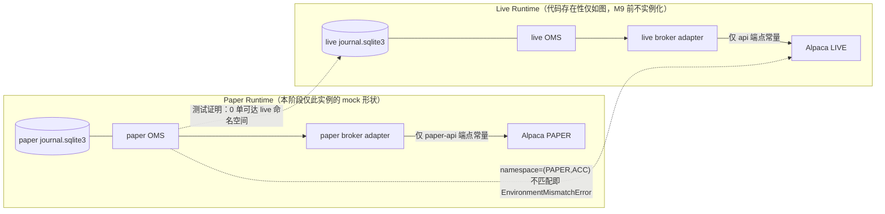

# M-1 工程验收报告（E-Gate）—— 开源底座真实 POC

| 字段 | 值 |
|---|---|
| stage_id | M-1 |
| commit | 最终提交 SHA 见本报告文末（随最终 commit 更新）；基线 commit `0c31e651`；POC 主提交 `11424ad6` |
| code_hash | 全部工件由 git 跟踪可重算；fake broker POC 代码位于 `artifacts/poc/M-1/fake_broker_poc/` |
| protocol_hash | NOT_APPLICABLE — 本阶段无研究协议（M3 才冻结） |
| environment | Windows 11 Pro 10.0.26200 / Python 3.13.15 / Git 2.55.0 / 强制代理 `http://192.168.1.2:8080`；无 Alpaca 密钥、无 LLM 密钥 |
| test_commands | 见 §6 测试命令清单 |
| evidence_paths | `artifacts/evidence/M-1/`、`artifacts/poc/M-1/` |
| findings | §5 |
| **status** | **PASS**（E-Gate，测试覆盖范围内；限定条件见 §5.3） |
| evidence_state | NOT_EVALUATED |
| deployment_state | NOT_DEPLOYED |
| strategy_role | NONE |
| final_holdout_status | SEALED |
| forward_window_status | NOT_APPLICABLE |
| next_gate | M0（部署隔离、签批契约、审计骨架）——等待用户审查本报告后另行授权 |
| approver | 待用户审查 |

**S-Gate**：N_A（见 `M-1-strategy.md`）；**R-Gate**：NOT_STARTED（见 `M-1-real-capital.md`）。

---

## 0. 与冻结基线的冲突处置

执行中发现并记录的冲突（授权要求：记录并解决后才实施）：

1. 文档位置：授权书引用 `docs/plans/`，实际文件在 `docs/` 根目录 → 已归位至 `docs/plans/`（baseline commit `0c31e651`）。
2. Python 版本：基线 §11.1 指定 3.11，本机无 3.11 → **用户中途指令改用 Python 3.13**；全部候选在 3.13 上真实评估，兼容性事实（含 qlib 需钉扎 `mlflow<3`、NautilusTrader 官方声明 3.13 支持等）已进入评估。
3. 项目非 Git 仓库而报告要求 commit 字段 → 已 `git init`，占位身份 `Shutu Lab Engineering <engineering@shutu.local>`（用户可改写）。
4. 基线 §17"停于 ENGINEERING_START_APPROVAL_PENDING" → 用户本会话已明确下达 M-1 启动授权，状态视为放行 M-1；其余阶段门不变。

详见 `artifacts/evidence/M-1/env/environment_and_decisions.md`。

## 1. 候选评估结论汇总（真实运行，非 README）

| 候选 | 锁定 SHA | 许可证 | Py3.13/Win | 结论 |
|---|---|---|---|---|
| alpaca-py 0.45.0 | `f8fd955` | Apache-2.0 | 安装+离线契约通过 | **采用**（BrokerAdapter 基座） |
| FinRL-Trading "FinRL-X" @ `4409abe` | `4409abe` | Apache-2.0 | 安装失败→偏差恢复后冒烟可跑 | **拒绝**（交易用途） |
| qlib 0.9.8 | `5435523` | MIT | 安装通过；工作流需 `mlflow<3` 后端到端跑通（10m27s） | 研究侧候选封装（M1 深化） |
| RD-Agent 1.0.0 | `484776c` | MIT | 安装通过；LLM 循环 `BLOCKED_ENV`；原生 Windows 不可用（需 WSL2） | 暂缓（M4 前不承诺） |
| nautilus_trader 1.231.0 / 2.0.0rc9 | `8a4ac22` | LGPL-3.0 | 安装+离线回测通过 | **拒绝**（无 Alpaca 适配器） |

各候选完整评估（每项 PASS/FAIL/BLOCKED_ENV/UNVERIFIED + 原始日志）：
`artifacts/evidence/M-1/candidates/{alpaca-py,finrl-x,qlib,rdagent,nautilus}/eval.md`

### 1.1 决定性事实

1. **FinRL-X 不具备订单安全语义的基础**：全仓库 `client_order_id` 0 命中、无对账/崩溃恢复/重试/部分成交处理、无事件循环；旗舰 paper 路径绕过其仅有的风控检查；6 个真实缺陷（含卖出腿 NameError、静默 $100 价格兜底、行情请求打到交易主机）；`dry_run=True` 仍发起真实 API 调用并把 401 吞成 warning（`candidates/finrl-x/logs/runtime_alpaca_offline.txt`）；README 宣称与代码不符；0 测试 0 CI；Python 3.13 按其 requirements 安装即失败（finnhub 死依赖，且该依赖 0 处被导入）。合成数据回测冒烟可跑（~4m52s，exit=0，仅证明管道运行，不构成任何策略证据）。→ 方案 A 拒绝。
2. **NautilusTrader 当前无 Alpaca 适配器**：clone、PyPI 稳定版 1.231.0、2.0.0rc9 三处 "alpaca" 均 0 命中（21 个适配器无 Alpaca）；持久化 journal 需 Redis/Postgres 且默认关闭；~49 万行代码（Rust 为主）。→ 方案 C 拒绝（保留重评条件，无自动路径）。
3. **alpaca-py + 最小 OMS 可行且已验证**：SDK 离线契约全部通过；我方最小 OMS 协议 ~500 行核心代码在 20 个契约用例下全过（§3）。→ 方案 B 采纳，详见 `docs/adr/ADR-001-core-selection.md`。
4. **alpaca-py 负面发现**：pydantic 模型接受负数量（qty/notional 互斥校验存在但符号校验缺失）→ 参数校验必须由我方 intent/风控层承担。
5. qlib 的 CN 样本数据存在**快照伪影**（88 个早于日历末端的标的中 87 个同日截止于 2020-09-25，非真实退市史）；公开数据止于 2022-12；PIT 成分格式（csi300 历史成员窗口）真实存在 → 数据必须另建，qlib 只可作引擎。引擎本身端到端可用：mlflow 3.x 会破坏其 recorder（`MlflowException: Run … not found`），在其自声明约束内钉扎 `mlflow<3`（实测 2.22.5）后 LightGBM Alpha158 工作流于 Windows + Py3.13 全程跑通（10m27s；IC 0.0468 / ICIR 0.3816，回测超额年化 +12.6% 不计成本 / +8.07% 计成本，与 qlib 官方参考一致——**此为库能力验证，非本项目策略证据**）。
6. RD-Agent 1.0.0（=锁定 clone 的 v1.0.0 tag）：安装成功（286 包，导入链实测 91.9s）；**原生 Windows 不可用于研究循环**（代码级 POSIX 假设：`/bin/sh -c` 包裹、`select.poll()`、unix socket 硬编码、`conda … | grep`，`rdagent/utils/env.py`）→ 部署目标须为 Linux/WSL2；Docker 非硬依赖（qlib 场景 `env_type` 默认 conda，docker 路径可选且本机无守护进程 `BLOCKED_ENV`）；LLM 循环因无凭证 `BLOCKED_ENV`（litellm Missing credentials，10 次重试后 RuntimeError，无 dry-run 模式）；默认模型 gpt-4-turbo、每提案 evolving_n=10 → LLM 成本需我方预算门；另发现其 LiteLLM 后端单次 chat 即 `AttributeError`（1.0.0 内部缺陷，`candidates/rdagent/logs/llm_probe.txt`）。

## 2. 必测项 1：fake broker 契约测试（20/20 PASS）

代码：`artifacts/poc/M-1/fake_broker_poc/`（仅标准库+pytest，Python 3.13）。
日志：`artifacts/evidence/M-1/fake_broker/pytest_run_1.log`。
设计决策与已知限制：`artifacts/poc/M-1/fake_broker_poc/README.md`。

| 基线要求场景 | 用例 | 结果 |
|---|---|---|
| 正常下单 | happy path 全成、WAL+synchronous=FULL 落库断言、先持久化后外发、确定性 client_order_id、重复 intent 拒绝、负数量 intent 层拒绝 | 5/5 PASS |
| 未知订单状态 | 响应丢失→按 client_order_id 对账采纳、0 重发；conn_refused→安全终止；transient 5xx→REJECTED 且无订单；UNKNOWN→HALT_NEW_RISK 且仅操作者解锁 | 4/4 PASS |
| 崩溃恢复 | 发送前崩溃→恢复补发恰好一次；发送后崩溃→采纳不重发；部分成交+崩溃→恢复补齐、事件去重；broker 重启后状态可对账 | 4/4 PASS |
| 双执行者冲突 | 旧 epoch 写入网关拒绝、过期租约失效、冻结执行者唤醒 0 双写、epoch 单调+owner 绑定（伪造 token 拒绝） | 4/4 PASS |
| （加测）环境隔离 | Paper 执行者无法写 Live 命名空间、Paper 配置含 live 工件被扫描拒绝、adapter 无布尔升级路径 | 3/3 PASS |

**不变量**：整个崩溃+恢复生命周期内 broker 对同一 intent 恰好收到 ≤1 次提交；UNKNOWN 未对账前 0 新增风险。

**边界声明（基线 §9 原文要求）**：mock/fake 通过**只证明本地契约**（持久化顺序、状态机、fencing、对账语义），**不证明真实 Alpaca 订单行为**（超时后查单返回、幂等窗口、回报格式）。

崩溃模型说明：注入异常（CrashBeforeSend/CrashAfterSend）+ SQLite WAL(synchronous=FULL) 已提交事务为持久性依据；子进程级 kill 与 ≥1,000 次故障组合属 M2 范围（§6.1）。

## 3. 必测项 2：日线与 5 分钟数据 POC（PASS）

代码：`artifacts/poc/M-1/data_poc/data_poc.py`；日志：`artifacts/evidence/M-1/data_poc_run.log`；输出：`artifacts/poc/M-1/data_poc/output/`（Parquet+manifest.json）。

| 项 | 实测结果 |
|---|---|
| 日线 | SPY、QQQ 各 501 行 × raw+adjusted 双口径，2 年跨度（2024-11-19 → 2026-11-18） |
| 5 分钟 | SPY 4,661 行，约 60 日 |
| UTC 存储 | ts_event_utc / ts_bar_close_utc / ts_available_utc 三列分离；Yahoo 时区为 America/New_York（实测 2026-11 为 EST -05:00，DST 正确） |
| 复权 | raw vs adjusted 差异行 SPY=457/501、QQQ=458/501（分红被反映）；**复权因子不可重算**（yfinance 不提供因子序列）→ 按基线 §4.1 属 REJECT_DATASET 级约束，仅限工程管道 POC |
| 前视检查 | 全部 5 个 Parquet 0 违规（event ≤ bar_close ≤ available 断言） |
| 数据源约束 | Yahoo 非官方 API、无 available_at、ToS 禁商用/再分发 → **仅限本地 POC**，M1 需替换为正式授权源 |

可复现性：脚本确定性；数据窗口随下载日期滚动（manifest 记录下载时刻与范围，诚实披露）。

## 4. 必测项 3：数据供应商七字段矩阵（PASS）

`artifacts/evidence/M-1/vendor_matrix.md`（检索日 2026-11-19，标 UNVERIFIED 项 M1 实测）：

- 历史成分/退市唯一可行解：**Sharadar (Nasdaq Data Link)**（10,000+ 退市公司、S&P500 历史成分含生效日期；现价 UNVERIFIED）。
- Alpaca Basic 免费层：实时仅 IEX、SIP 延迟 15 分钟（官方文档核实）；全 SIP $99/月。
- Polygon.io（2026 改名 Massive）：$0/$29/$79/$199 档（检索核实）；退市覆盖深度 M1 实测。
- qlib 公开样本：无 PIT 成员之外的退市支持，禁入研究证据链。
- Yahoo：RESTRICT_SCOPE / REJECT_DATASET 级约束（见 §3）。

## 5. 许可与供应链（PASS）

- 唯一台账：`docs/licenses/third-party.md`（候选 SHA/许可证/义务 + 直接依赖 + 数据源约束）。
- 全部克隆为 depth-1，SHA 可追溯；未 fork、未修改上游；修改义务评估（LGPL 条款）已记录。
- 各候选独立 venv 完整依赖清单在各候选 logs/ 下（qlib 195 包、rdagent 数百包——依赖足迹本身是选型输入）。

### 5.3 E-Gate 限定条件与未决项（不阻塞本门，进入下一门前必须处理）

| 项 | 状态 | 说明 |
|---|---|---|
| Alpaca 真实订单语义 | **BROKER_BEHAVIOR_UNVERIFIED** | Paper API 属可选验证，本环境无密钥未运行（按基线 §9 这≠BLOCKED_ENV）。**M2 前必须完成 Paper 实测**（需用户提供 paper key 并授权） |
| RD-Agent LLM 研究循环 | **BLOCKED_ENV**（部分） | 无 LLM 凭证；安装/CLI/代码审查已完成。若 M4 采用需先补凭证与预算门 |
| qlib US 数据管道 | UNVERIFIED | CN 样本验证了引擎；US 数据接入成本 M1 评估 |
| 供应商矩阵现价 | UNVERIFIED | Sharadar 现价等以订购页为准 |
| ≥1,000 故障组合 + 子进程 kill | 属 M2 | 本阶段为契约级（20 用例），规模扩展是 M2 任务 |

## 6. 测试命令清单（真实执行）

```text
# 环境
py -3.13 -m venv .venv; .venv/Scripts/python.exe -m pip install --proxy http://192.168.1.2:8080 ...

# fake broker 契约测试（20 用例）
cd artifacts/poc/M-1/fake_broker_poc
D:/dev-projects/Shutu-AI-Trading-Lab/.venv/Scripts/python.exe -m pytest -v

# 数据 POC（日线+5分钟）
export HTTPS_PROXY=http://192.168.1.2:8080 HTTP_PROXY=...
.venv/Scripts/python.exe artifacts/poc/M-1/data_poc/data_poc.py

# alpaca-py 离线契约
.venv/Scripts/python.exe（heredoc 脚本，见 candidates/alpaca-py/logs/offline_contract.txt）

# 候选克隆（全部经代理，depth-1）
git clone --depth 1 https://github.com/{microsoft/RD-Agent, microsoft/qlib,
  AI4Finance-Foundation/FinRL-Trading, alpacahq/alpaca-py,
  nautechsystems/nautilus_trader}.git third_party/<name>

# 各候选安装/运行：见各 eval.md 引用的 logs/*.txt（逐条命令+完整输出）
```

## 7. 独立部署与不可共享账户写权限方案（mock 已测）



测试证据：`test_05_env_isolation.py`（3 用例）——Paper 执行者指向 Live 账户/环境被拒、Paper 配置含 live URL 被扫描拒绝、adapter 命名空间不可变（无布尔升级路径）。生产级隔离（进程/密钥域/DB 分离）是 M0 任务，本阶段仅证契约形状。

## 8. 未解决问题与 M0 开发依赖

1. **BROKER_BEHAVIOR_UNVERIFIED 缺口**：真实 Alpaca（先 Paper）订单协议语义必须在 M2 OMS 实装前实测；需用户提供 paper key + 明确授权。
2. **数据源替换**：Yahoo 只用于 POC；M1 按 `configs/data_acceptance.yaml` 完成正式供应商验收（Sharadar/Polygon/Alpaca 候选）。
3. **MLflow/qlib 耦合**：若 qlib 进研究栈，钉扎 `mlflow<3` 并跟踪上游修复。
4. **RD-Agent 预算与沙箱**：M4 前需 LLM 凭证、预算硬门与 Docker 依赖的部署决策。
5. **M0 直接依赖本阶段产物**：ADR-001（本报告 §1）决定 brokers/oms 模块形状；fake broker 契约（§2）升级为 M2 的生产 OMS 验收基础；供应商矩阵（§4）是 M1 data_acceptance.yaml 的初稿。

## 9. 采用/封装/参考/拒绝汇总（结束条件 1）

| 处置 | 组件 |
|---|---|
| **采用** | alpaca-py 0.45.0（BrokerAdapter）；SQLite WAL 持久化模式（本 POC 验证） |
| **封装（受控复用，不拼接）** | qlib 0.9.8（候选：仅作研究引擎，数据另建）；RD-Agent 1.0.0（暂缓，M4 再议） |
| **仅参考** | FinRL-X（权重→订单再平衡思路；其缺陷清单作为 OMS 验收负例来源）；AI Hedge Fund/TradingAgents（基线 §3 即定位为参考，未深入评估） |
| **拒绝** | FinRL-X 作为交易模块；NautilusTrader（当前无 Alpaca 适配器 + 复杂度不匹配；保留重评条件） |

---

**E-Gate 结论：PASS**（测试覆盖范围内）——fake broker 四类必测场景全部通过且留证、日线+5 分钟 POC 可复现、供应商七字段矩阵具备、上游 SHA/许可可追踪、三轨状态如实（S=N_A / R=NOT_STARTED）。限定条件（§5.3）已如实列出，不构成降低验收标准。

**停止声明**：M-1 到此为止。未进入 M0，未连接任何券商，未开启 Live，未触碰真实资金。等待用户审查。
